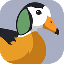
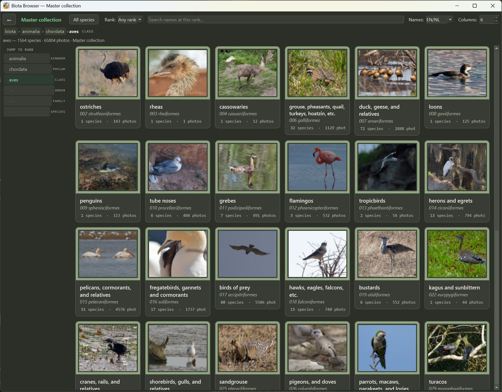
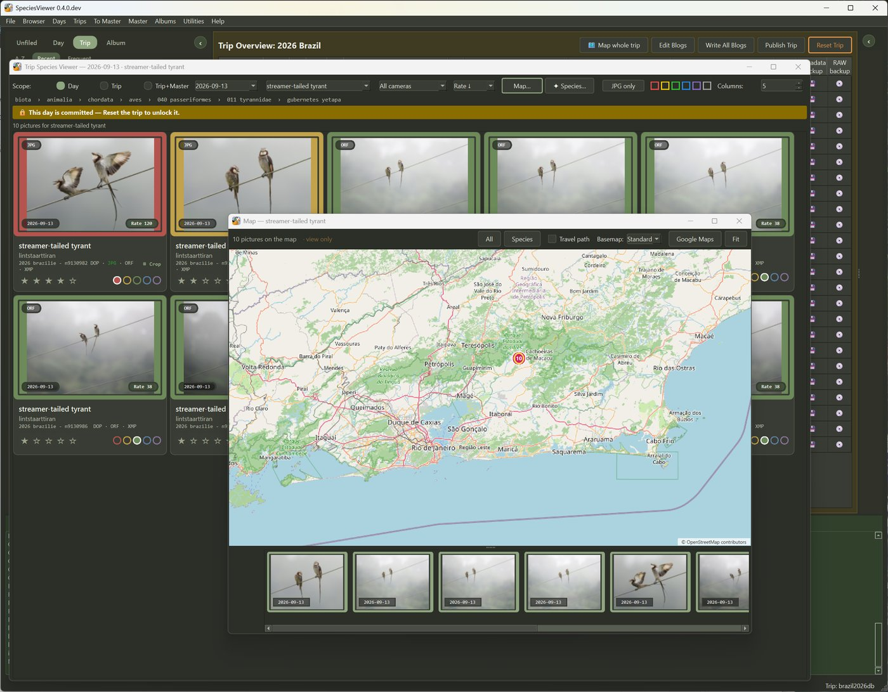
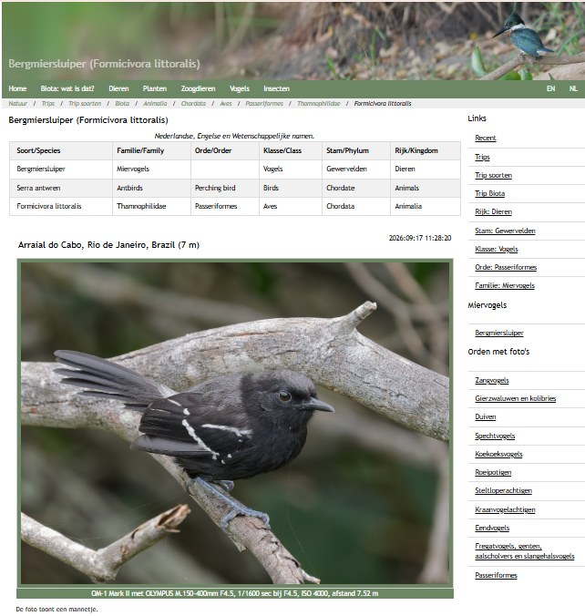

  

<h1 align="center">SpeciesViewer</h1>

<em>Organize species. Explore collections. Bring biodiversity to life.</em>

SpeciesViewer is a desktop program for nature photographers who think in **species**, not in
folders. It takes you from a full memory card to a lasting collection: cull and identify your
pictures, keep the best of every species in one collection, write up your trips, and — if you
want — publish it all as a website.

It works for birds, but just as well for plants, fungi, insects, dragonflies and mammals: every
picture is tied to a species name, and the names follow the scientific classification
(via [GBIF](https://www.gbif.org)), in English, Dutch or the scientific name.

A trip can easily bring home 25,000 pictures. SpeciesViewer helps you cull them, name the
species in the keepers, and put every picture on the map — from a GPS track, from the
position the camera recorded, or by hand on the map. A finished trip goes into your master
collection, where it joins everything you photographed before.

Your collection is plain folders and files: the pictures, their XMP sidecars and a few CSV
lists. There is no database to install, and no database upgrade with a new version.

  
   <em>The Biota browser — the whole collection by family, genus and species.</em>

---

## What it does

- **From card to keepers.** Read a memory card, cull with colour labels and ratings, and name
  the species in each picture — RAW, HEIC and JPG, with the camera's own preview for speed.
- **One collection that lasts.** The *master* holds the best pictures of every species you have
  photographed, with their date, place and rating. Adding a day or a trip updates it; a better
  picture replaces a weaker one.
- **Trips with a story.** A trip gets a page per day with a written blog, the species seen that
  day, a map of where the pictures were taken, and a trip overview with the full species list.
- **Albums.** Pick any range of dates from the master — a country, a season, a theme — and get
  an album with its own pages, without copying a single picture.
- **Browse it all offline.** The Biota browser shows the whole collection by family, genus and
  species, with maps, on your own computer.
- **A website, if you want one.** Publish to your own web server, or keep the website on your
  computer only. Publishing is optional; everything else works without it.
- **Works with DxO PhotoLab.** SpeciesViewer reads and writes PhotoLab's sidecar files, so your
  edits and colour labels stay in step, and uses PhotoLab's high-quality JPGs for publishing.
  PhotoLab is not required.

  
   <em>A trip day: every picture of one species, and where it was taken.</em>

  
   <em>A species page on the website: names, classification, the best pictures and a map.</em>

The complete list, chapter by chapter, is in
[What SpeciesViewer can do](docs/SpeciesViewer_Capabilities.html); the
[reference manual](docs/manual/) explains every menu.

## Getting it

| | |
|---|---|
| **Windows 10 / 11** | A download is coming soon. Until then, run it from source — see [Installing SpeciesViewer](docs/install.md). |
| **macOS, Linux** | Written to run there too, but not yet ported or tested — see [Installing SpeciesViewer](docs/install.md). |

On first start, **Help ▸ Setup Checklist** shows what to set up and in which order: a master
collection first, then — only if you want them — trips and a website.

## Good to know

- **Culled and deleted pictures stay available** in a trash folder until you empty it.
- **Your settings** live in your user folder (`%LOCALAPPDATA%\SpeciesViewer` on Windows),
  never in the program folder.
- **Online services:** species names come from GBIF, maps and place names from OpenStreetMap,
  translations from Google Translate. Without internet, SpeciesViewer keeps working with what
  it already knows.

## Questions, ideas and contributions

Bug reports, questions and ideas are welcome as
[GitHub issues](../../issues), or by e-mail to
[speciesviewer@houtekamer.com](mailto:speciesviewer@houtekamer.com).

Code contributions are welcome too. Please open an issue first to talk about what you have in
mind, so your work fits in and is not done twice. Contributions are accepted under the same
licence as SpeciesViewer.

## Licence

SpeciesViewer is free software under the **GNU General Public License, version 3** — see
[`LICENSE`](LICENSE). It builds on the work of many others; they are credited in
[`NOTICE.md`](NOTICE.md), which the program also shows under *Help ▸ About ▸ Licences and
credits*.

Copyright © 2024–2026 Gilbert Houtekamer. The pictures in the program and this repository are
the author's own.
