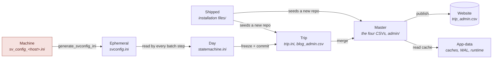

# Configuration & data files — the inventory

*Backlog ch.19, "Configuration files have never been inventoried".*

There has never been a single statement of which `.ini`, `.json` and `.csv`
files exist, which are per-machine, which travel with a trip, and which are
throwaway caches. Two decisions in one working day needed that answer — where
the SD-card prefix should live, and whether the settings snapshot written to a
camera card may carry the GUI cache (it may) or the file holding the website
password (it must not) — and both were settled by reading source. This is the
table that answers them without reading source.

This document replaces the older `config_state_files.md`, whose delete-safety
verdicts and machine-config key list are folded in below. Companion documents:
[manual/appendix-e-data_structures.md](manual/appendix-e-data_structures.md) for how the four picture CSVs
reference each other, and
[manual/howto_trip_index_publication.md](manual/howto_trip_index_publication.md) for the one file whose
authoritative copy lives on the website.

**Reading the verdict column.** 🟢 rebuilt automatically, no risk. 🟡 rebuilds,
but costs time or loses convenience state. 🔴 canonical — loss is permanent, or
breaks an undo.

---

## The nine scopes

Every file below belongs to exactly one of these. **Naming the scope is the
whole decision** — where a setting goes, whether it may be copied, and what
happens when it is lost all follow from it.

| Scope | Lives in | One copy per | Travels? |
|---|---|---|---|
| **Shipped** | the source tree | release | with the code |
| **Machine** | repo root (today — see *Known irregularities*) | computer | **never** |
| **App-data** | `%LOCALAPPDATA%\SpeciesViewer\` (Win), `~/Library/Application Support/SpeciesViewer/` (Mac) | computer | never |
| **Ephemeral** | repo root, rewritten per run | run | never |
| **Master** | `<master>/` — Dropbox | collection | via Dropbox, to your own machines |
| **Trip** | `<trip>/` — Dropbox | trip | with the trip (export, Dropbox) |
| **Day** | `<trip>/metadata/review/<date>/` | shooting day | with the trip |
| **Picture folder** | beside the RAWs, on the working disk | folder | with the pictures |
| **Website** | the server | site | it *is* the destination |

> The red box is the one scope that must **never** be copied anywhere: it holds
> the SFTP password.

---

## Two questions this table exists to answer

**Where does a new setting go?** Work down this list and stop at the first yes:

1. Does it differ per **shooting day** (a pipeline step's progress)? → `statemachine.ini`.
2. Does it belong to **this trip**, and should someone opening the trip on another machine see it? → `trip.ini` / `virttrip.ini`.
3. Does it belong to the **whole collection** (published state, species knowledge)? → a file under `<master>/admin/`.
4. Is it a **credential or a path** that is true only of this computer? → `sv_config_<host>.ini`.
5. Is it a **convenience** — last folder used, a toggle, a window position — that nobody would miss? → `sv_gui_cache.json`.
6. Is it **derived and rebuildable**? → app-data cache. Never Dropbox, never the source tree.

Never add it to `svconfig.ini`: that file is rewritten from scratch before every
batch run.

**What may be copied off this machine?** Only the ✅ rows in the *Copy* column
below. The rule has one hard case worth stating outright: `svconfig.ini` looks
like a harmless generated file and carries `[websettings] Sftppwd` in clear
text. The work-backup written to a camera card therefore copies
`sv_gui_cache.json` and nothing else ([work_backup.py:623](../speciesviewer/engine/work_backup.py#L623)).

---

## Machine scope — one per computer, never copied

Since 0.4 (2026-10-10) these live in the per-OS app-data folder, not the
repository root: settings in **`config/`**, remembered state in **`state/`**
(`%LOCALAPPDATA%\SpeciesViewer\…` on Windows). `utils/config.py` moves them
there once, renaming the old copy `<name>.moved-to-appdata`.

| File | Format | Holds | Copy? | Lose it? |
|---|---|---|---|---|
| `sv_config_<hostname>.ini` | ini | **The** machine config: every repository path, `[websettings] Sftppwd` + `base_url`, `[translate] google_api_key`, window geometry, RAW-decode knobs, cache overrides, per-machine EXIF worker count. Created as a `[Global]` stub on first run. | 🔴 **never** — password | 🟡 re-enter every path and the SFTP password |
| `sv_config.ini` | ini | Legacy fallback, same schema, used when no hostname file exists. | 🔴 never | 🟡 |
| `photolab_denoise.ini` | ini | DxO PhotoLab denoise codes per installed PL version, seeded from built-in defaults. Written only on the crop path. | ✅ | 🟢 reseeded |
| `days_<hostname>.json` | json | The "Days" lane: ad-hoc `YYYY-MM-DD` folders being reviewed and their status. Real state lives in the XMP sidecars; this is only the list. | ✅ | 🟡 re-add the folders |
| `sv_gui_cache.json` | json | Convenience state: `recent_projects`, `trip_project_map`, `sdcard_ingest` (**the card prefix**), `culling_species` (last-20 species LRU), `usage_stats`. **No credentials** — which is why this one may ride along on a card. | ✅ | 🟢 rebuilt by use |
| `speciesviewer.log` | text | This run's log (`studio.log` until 0.5.0); earlier runs kept as `speciesviewer-<date>.log` for 14 days. | ✅ | 🟢 |

### What lives inside `sv_config_<hostname>.ini`

| Section | Key examples | Purpose |
|---------|-------------|---------|
| `[Global]` | `config_version`, `dxo_path`, `exiftool_path` (optional — set by Setup Checklist ▸ Locate…; empty = shipped copy, else the PATH; see `utils/exiftool_path.py`), `debug_tools`, `photolab_handover_delay_s`, `end_of_list_sound` | App-wide defaults. `photolab_handover_delay_s` (default 5, hand-edit only): seconds a running PhotoLab gets to re-read the folder before *Open in PhotoLab* writes the held crop/exposure edits to the `.dop`. `end_of_list_sound` (default yes, hand-edit only): the soft tick when the Editor is at the first/last picture |
| `[Master]` | `masterbiotadatabase`, `masterbiotawebroot`, `readonly` | Path to the master collection |
| `[Trip]` | `tripbiotadatabase`, `tripbiotawebroot` | Active trip: database path and **web slug** |
| `[VirtTrip]` | `virttripbiotadatabase`, `virttripbiotawebroot` | Active album |
| `[project]` | `picturedirectory` | The day folder currently being worked on |
| `[websettings]` | `Sftppwd`, `base_url`, `sftp_host`, `sftp_user`, `sftp_remote_root`, `contact_email`, `publish_target` (`local` / `server`; empty = not chosen — a setup with server fields filled counts as `server`), `local_port` (optional, default 8765) | **The credential.** Why this file never leaves the machine. The local website itself lives in `<master folder>/website` (app-data), served by `utils/local_web.py` |
| `[translate]` | `google_api_key` | **A second credential.** Google Cloud Translation API key (restricted to that API). When set, translation asks Google's official service first; without it the free Google page and MyMemory are used. Hand-edit with the app closed; each machine needs its own entry |
| `[fullres]` | `algorithm`, `fbdd`, `bright`, `denoise`, `scale` | RAW decode quality for the 100% view |
| `[preview]` | `max_long_edge` (3200), `quality` (90) | Size the embedded camera previews are normalised to. `0` = keep whatever the camera embedded |
| `[createjpg]` | `resize_above` (3200), `max_long_edge` (2000) | Create JPG resamples only when the longest edge (after any crop) exceeds `resize_above`, and then down to `max_long_edge`. The GAP is the point: nothing between them is touched, so an OM-1's 3200 px preview and a phone screenshot are kept as-is while an iPhone frame (5712) and a 45 MP body are reduced. No per-format exception. `resize_above = 0` never resamples. Set in **Look & Feel ▸ Make JPG — resize** |
| `[avibase]` | `source_format`, `phone_layout`, `first_column_lang`, `columns` | Excel checklist export, plus the per-list column map in `[avibase_columns]` |
| `[masterdb]` | `pending_warn_seconds`, `checkpoint_debounce_seconds` | SQLite write-queue behaviour |
| `[performance]` | `exif_workers` | Parallel exiftool workers. `auto` ≈ physical cores, capped 16. Hardware-dependent, hence machine scope |
| `[caches]` | cache-root overrides | Where the app-data caches actually live |
| `[WindowState]` | `<dialog>_x/_y/_w/_h`, `_vsplit`, `_hsplit` | Per-dialog geometry, one entry per window |
| `[PhotoSorter]` | `last_source_folder`, `last_dest_folder` | Last SD-card and destination paths |
| `[currentpictures]` | `rootdirectory` | The working-picture root (e.g. `D:\CurrentPictures`). A trip.ini stores `picture_root` RELATIVE to this, so the trip stays portable between machines whose absolute paths differ |
| `[gpslogs]` | `rootdirectory` | **Optional override.** GPS tracklogs live in `<CurrentPictures>/gpslogs/<year>/<yyyymmdd>.log` and `get_gpslogs_root()` derives that path, so this key is normally absent. Set it only to put the logs somewhere else |

## Ephemeral — rewritten before it is read

| File | Format | Holds | Copy? | Lose it? |
|---|---|---|---|---|
| `svconfig.ini` (app-data `runtime/` since 0.4 — `utils.runtime_files.svconfig_path()`) | ini | The batch handoff: repository paths, picture directory, avibase settings — **and the SFTP password**. Regenerated by `generate_svconfig_ini()` immediately before each batch run from the machine config. | 🔴 **never** — password | 🟢 always regenerated |
| `sv_addmaster_svconfig.ini`, `sv_regenspecies_svconfig.ini`, `svReadDir.ini` | ini | Same shape, written for specific long-running steps so a second run cannot clobber the first. | 🔴 never | 🟢 |

> **⚠ Hand-editing `svconfig.ini` accomplishes nothing** from the GUI: it is
> overwritten before the module that would read it starts. Flags documented as
> living there — `[virttrip_addtomaster] read_from_local` is the notable one —
> are reachable only by running a batch script from a command line with its own
> config file. `BatchModuleRunner` accepts `config_overrides` for the cases that
> need to come from a dialog.

## App-data — derived, rebuildable, machine-local

| File | Format | Holds | Lose it? |
|---|---|---|---|
| `db/master.db` (+ `-wal`, `-shm`) | SQLite | Read-cache of the master, rebuilt when the master CSVs change. | 🟡 slow rebuild |
| `db/master.wal.jsonl` | jsonl | Append-only intent log of master writes not yet checkpointed into the CSVs. | 🔴 **an entry here is a real write that has not landed** |
| `fullres_cache/`, `preview_cache/` | jpg | Decoded previews, keyed by source path. | 🟢 recomputed |
| `runtime/last_blog_url.txt`, `last_website_url.txt` | text | Batch→GUI handoff so "open in browser" knows what was just published. Absolute paths via `utils/runtime_files.py`, because the two processes do not share a working directory. | 🟢 |

## Master scope — one per collection, shared through Dropbox

| File | Format | Holds | Lose it? |
|---|---|---|---|
| `metadata/active/data_pictures.csv` | csv | One row per camera click. | 🔴 canonical |
| `metadata/active/data_files.csv` | csv | One row per physical file. | 🔴 canonical |
| `metadata/active/species.csv` | csv | Per-species record: counts, best JPG, target path. | 🔴 canonical |
| `metadata/active/speciescollection.csv` | csv | Taxonomy with parent/child links and vernacular names. | 🔴 canonical |
| `metadata/active/backup/<date>/*.csv.gz` | csv.gz | Daily snapshot of the three master CSVs (154 MB raw → ~7.3 MB, ~1 s), taken silently at startup and pruned to the newest 14; `manifest.json` records the row counts and the consistency verdict at the time. **A backup is REFUSED when the master fails its check** — a snapshot of a broken master would eventually push the last good one out of the rotation. | 🔴 never by hand — it prunes itself; Database Settings ▸ Restore… puts one back |
| `metadata/active/backup/pre-restore-*/` | csv.gz | The CSVs a Restore replaced, so a restore is itself reversible. | 🟡 only once you are certain the restore was right |
| `metadata/cache/exif_cache.json`, `exif_cache_master.json` | json | EXIF cache, immutable (RAW by name+size) and mutable (XMP/JPG by path+mtime) buckets, three rotating `.bak`s. | 🟡 full re-scan |
| `admin/trip_admin.csv` | csv | Every trip **and** album listed on the public Trips page. **A mirror** — the live copy on the website is authoritative. See [manual/howto_trip_index_publication.md](manual/howto_trip_index_publication.md). | 🟡 restored from the live site |
| `admin/blog_admin.csv` | csv | Merged blog metadata across trips. | 🔴 |
| `admin/TransCache.csv` | csv | Translation cache (NL↔EN), master-wide. A trip carries its own; they are never merged across repositories. | 🟢 re-translated |
| `admin/trip_species_summary.csv` | csv | One row per trip: species, lifers, date range, which counting rule applied. Survives the trip repo. | 🔴 not regenerable |
| `admin/trip_reports/<trip_id>*.txt`, `* baseline.csv` | txt/csv | The Count Species report as it stood at merge time. | 🔴 not regenerable |
| `admin/master_commits.csv` | csv | Which picture roots have been committed into the master, keyed by picture root. | 🟡 |
| `admin/status/display_status.csv` | csv | The "no website picture" report: stale / raw-only / orphan. | 🟢 regenerated |
| `tripindex-nl.html`, `tripindex-en.html` (master **root**) | html | The generated public Trips page, rendered from `trip_admin.csv` and uploaded to `/nature/`. | 🟢 regenerated |
| `smallmaster.json` | json | Snapshot stamp inside `smallmaster.zip`: when this SmallMaster was taken. | 🟢 |
| `.trash/trash_manifest.csv` | csv | Audit log of every delete: timestamp, UPN, original path, trash path, batch ID. | 🔴 it is the undo record |
| `.trash/<date>/<upn>/` | files | The trashed picture files themselves (RAW + XMP + sidecar; JPGs are never trashed). | 🔴 only remove to free space, once certain |
| `.trash/snapshots/<batch>.json` | json | The DB rows removed in one batch delete, for `undo_delete()`. | 🔴 |

## Trip scope — travels with the trip

| File | Format | Holds | Lose it? |
|---|---|---|---|
| `trip.ini` / `virttrip.ini` | ini | Trip identity: `trip_name`, `trip_id`, `web_slug`, date range, banner and picture, picture root, name profile, NL/EN title and message. Hand-authored, never regenerated. | 🔴 |
| `metadata/active/*.csv` | csv | The four structures again, trip-sized. Overwritten by WriteCommit. | 🔴 |
| `metadata/frozen/frozen_data_*.csv`, `allspecies.csv` | csv | The reviewed snapshot the commit promotes to `active/`. | 🔴 |
| `metadata/backup/<date>_data_*.csv` | csv | Pre-commit checkpoints. | 🟡 |
| `metadata/blog/blog_<label>.ini` | ini | Per-day blog draft of an **album** (title, message, selection). | 🔴 hand-written text |
| `metadata/initialize/master_species_baseline.csv` | csv | The master's species list frozen at trip creation. A **fallback only**: Count Species normally judges "new to me" against everything the master has a picture of from before the trip's `fromdate`. Written once by `sv1MakeReposity`; Reset Trip does not touch `initialize/`. | 🟢 for any trip with a `fromdate`; 🔴 for one without — it would otherwise fall back to the live master and report zero lifers |
| `metadata/reports/Species overview.txt` | txt | The latest Count Species report for this trip; the merge archives a copy into the master. | 🟢 regenerated, as long as `metadata/review/` still holds the day summaries |
| `admin/blog_admin.csv` | csv | Per-day blog metadata for a **trip**. | 🔴 hand-written text |
| `admin/TransCache.csv` | csv | This trip's own translation cache; exported with it. | 🟢 |
| `admin/FTPcache.json` | json | Remote directory listing, to skip redundant uploads. Deliberately **not** exported. | 🟢 |
| `admin/survivors.json` | json | Which files survived the culling, so re-reading a work backup re-applies it. | 🟡 |
| `admin/speclist.csv` / `.txt` | csv/txt | Species added during this trip; informational output. | 🟢 |
| `export.ini` | ini | The manifest riding along in a trip export ZIP: identity, publication state, day counts. | 🟢 rebuilt per export |

## Day scope

| File | Format | Holds | Lose it? |
|---|---|---|---|
| `statemachine.ini` | ini | The sv1–sv7 progress tracker for this day: a boolean and a message per step. | 🟡 re-runs every step |
| `data_files.csv`, `data_pictures.csv`, `species.csv` | csv | This day's EXIF read, picture summary and species assignments. | 🟡 re-run sv2/sv3 |

## Picture-folder scope — beside the RAWs

| File | Format | Holds | Lose it? |
|---|---|---|---|
| `blog.ini` | ini | The day's blog draft for a **regular trip** — written next to the pictures, not in the trip repo. | 🔴 hand-written text |
| `.sv_sidecar_cache.json` | json | Rating, label, species, GPS per XMP in that folder; staleness by mtime. | 🟢 one exiftool batch |
| `.sv_ingest_cache.json` (SD card) | json | SHA-256 of files already copied from this card, for incremental top-up. | 🟢 full re-hash |
| `<name>.xmp`, `<name>.dop` | xml/ini | The photographer's truth: rating, colour, crop, species. Not ours to invent — a `.dop` is written only when PhotoLab authored one. | 🔴 |

## Shipped with the source

`speciesviewer/dist/installation files/` holds `empty_data_files.csv`,
`empty_data_pictures.csv`, `empty_species.csv` and
`initial_speciescollection.csv` — the templates that seed a new repository.
`dist/includes web/` holds the placeholder `tripbanner.jpg` / `tripimage.jpg`
and the page templates. Read-only at runtime.

---

## Known irregularities

Worth knowing before they surprise you; each is a real observation from the
source, not a suspicion.

1. ✅ **FIXED 2026-10-10 (0.4)** — files now in app-data `config/` + `state/`; see docs/plans/config_out_of_repo.md. *Was:* **The machine config lives in the repository root.** `CONFIG_DIR` is the
   source tree ([utils/config.py:12](../speciesviewer/utils/config.py#L12)), so
   `sv_config_<host>.ini`, `days_<host>.json`, `sv_gui_cache.json`,
   `photolab_denoise.ini`, `svconfig.ini` and `speciesviewer.log` all land among the
   code. Fine for a clone in `d:\code`; it is exactly the first-run blocker
   ch.20 names, because an installed application directory is not writable.
   `utils/cache_paths.app_data_dir()` is already the right destination and is
   already used by the caches and by `runtime_files`.
2. ✅ **FIXED 2026-10-10 (0.4)** — now `STATE_DIR / sv_gui_cache.json`. *Was:* **`sv_gui_cache.json` resolves against the working directory**, not
   `CONFIG_DIR` — it is a bare `Path("sv_gui_cache.json")`
   ([utils/gui_config.py:6](../speciesviewer/utils/gui_config.py#L6)). Launch
   the app from a different folder and it silently starts a second, empty cache.
   This has already happened: alongside the live 6.7 KB cache in the repo root
   there is a 222-byte orphan in `speciesviewer/` holding two sections from
   2026-08-10, and a stale `svconfig.ini` beside it. Neither is read today, and
   nothing warned that a second one had been started. Deleting both is safe;
   the fix is to route the file through `CONFIG_DIR` like every other
   machine-scope file.
3. **Two files named `blog_admin.csv`** — one in the trip's `admin/`, one in the
   master's, and the merge step copies between them. And a trip's day-blog draft
   is `blog.ini` *next to the pictures*, while an album's is
   `metadata/blog/blog_<label>.ini` *inside the repo*. Same job, three homes.
4. **`.ini` files must be read through `utils/ini_io.read_ini`**, never
   `ConfigParser.read()`: the latter uses the locale encoding, which turns
   `Brazilië` into a path that names no file. Anything both read and written
   needs one explicit encoding on both ends — the asymmetric contract is what
   corrupted `virttrip.ini` in 2026-07.
5. **`admin/trip_admin.csv` is the only file whose authority lives on the
   website.** Your local copy is rebuilt from the live one on every publish.
6. **`FTPcache.json` is per-trip and per-machine at once** — it describes a
   remote directory, but it is stored in the trip, so it travels and then
   describes uploads that this machine never made. It is excluded from trip
   exports for that reason.

## Deletion cheat sheet

| 🟢 Safe to delete | `speciesviewer.log`, `sv_gui_cache.json`, `svconfig.ini`, `fullres_cache/`, `preview_cache/`, `runtime/*.txt`, `FTPcache.json`, `speclist.*`, `TransCache.csv`, `display_status.csv`, `.sv_sidecar_cache.json`, `.sv_ingest_cache.json`, `exif_cache*.bak*`, `master.db-wal`, `master.db-shm`, `metadata/reports/*` |
| 🟡 Caution | `sv_config_<host>.ini` (paths + password), `days_<host>.json`, `master.db` (slow rebuild), `exif_cache*.json` (slow re-scan), `statemachine.ini` (re-runs every step), `metadata/frozen/`, `metadata/backup/`, `admin/trip_admin.csv`, `admin/survivors.json`, `master_species_baseline.csv` |
| 🔴 Never delete | `data_pictures.csv`, `data_files.csv`, `species.csv`, `speciescollection.csv`, `trip.ini`, `virttrip.ini`, `blog.ini`, `blog_admin.csv`, `master.wal.jsonl`, `.trash/**`, `admin/trip_species_summary.csv`, `admin/trip_reports/**`, `*.xmp`, `*.dop` |

## Rules for adding one

- State the scope first, in the module docstring. Every bug in this list started
  as a file whose scope was never named.
- One canonical copy. If a second copy is unavoidable, say in writing which one
  wins.
- A cache must survive being deleted, and must not live in Dropbox.
- Never write a credential to anything outside machine scope.
- Never write a master CSV to zero rows: a failed read must not become an empty
  write.
