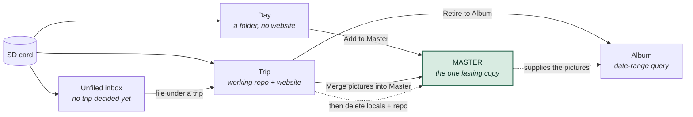

# Concepts

> The same story at a lower level — the physical repositories, the copy gates
> and the delete arrow — is [Appendix C](appendix-c-data-architecture.md).

Everything in SpeciesViewer happens inside one of four **scopes**. Almost every
question of the form *"why can't I click that?"* or *"where did my pictures
go?"* is really a question about which scope you are in and what that scope
owns. Learn these four and the menus stop being arbitrary.

---

## The four scopes at a glance

| Scope | Lives in | Owns pictures? | Has a website? | Lifetime |
|---|---|---|---|---|
| **Day** | any `YYYY-MM-DD` folder you point at | The originals, in place | No | As long as you want; it is just a folder you registered |
| **Trip** | `…\trips\<name>db` | Only the published JPGs; the RAWs you cull live in a separate `CurrentPictures` folder | Yes — `/trips/<slug>` | The working area until its pictures are in the master and an album has taken over; then retired |
| **Master** | `…\naturedb` | **Yes — the permanent store** | Yes — `/nature` | Permanent |
| **Album** | `…\virttrips\<name>` | None — its pages are built from the master | Yes — `/trips/<slug>` | Permanent, cheap |

The single most important sentence in this manual:

> **The Master is the only copy that lasts.** The trip repository is scaffolding,
> the album is a query, and the local working files get deleted on purpose once
> the master physically holds them. If something must survive, it must be in the
> master.


---

## Day

A **Day** is one date's folder of pictures, registered in a list so the
application can find it again. Nothing more. There is no repository, no
metadata tree, no blog and no website.

Use a Day for the local outing: a birding morning where you shot 300 frames, or
a targeted trip to one site after one species. You want to cull, identify what is
in the pictures, and put the keepers in the master. Building a whole trip for
that would be ceremony with no payoff.

The Day lane is deliberately short: **register or copy in → review & rate →
Add to Master**. That is the whole life of a Day. See [Chapter 3](03-days.md).

A Day is *not* a step on the way to a Trip. It is a parallel, lighter route to
the same destination (the master). Adding a Day to the master refreshes the
master website exactly as a trip merge would — new species appear, and a
better-rated picture replaces a weaker one for a species you already had.

You may well prefer this lighter approach for most of your photography. The one
thing it does not give you is a written-up journey: no per-day blog, and no trip
overview page listing the species you saw.

## Trip

A **Trip** is a working repository — a folder like `kretadb` holding metadata,
per-day review data, blog drafts, and copies of the pictures that make it onto
the trip website. It is the only scope with the full per-day **pipeline**:

```
1. Read & Summarize  →  2. Write Blog  →  3. Publish Day
```

run once per day of the trip, then, across the whole trip:

```
4. Make the Blogs Clickable  →  5. Manage Trip Publication
```

A trip is a **safe workspace**. You can cull, organise and lay out a journey
freely, and nothing you do there can reach the master. When the trip's
organisation and story are the way you want them, you move its pictures into the
master; its blogs and species list migrate to an **Album** automatically, keeping
the same web address, and the working repository — its job done — is retired.

Two roots matter and are easy to confuse:

- The **trip repository** (`…\trips\kretadb`) — metadata, per-day review data and
  website files: the bookkeeping that drives the culling and builds the trip site.
- The **picture root** (`D:\CurrentPictures\2026\2026 Crete`) — the actual RAW
  files you are culling, one `YYYY-MM-DD` folder per day. It is not part of the
  repository, but SpeciesViewer does delete files here during culling — the
  frames you reject.

## Master

The **Master** (`naturedb`) is your collection: every species you have
photographed, across every trip, good shots and mediocre ones alike, plus the
canonical CSVs that hold the biological knowledge — the species list, the
translations, the per-picture metadata.

It is fed mainly **through a trip**. The to-master step takes everything the trip
has selected — identified species and landscapes, RAW files and their JPG renders
alike — copies it into the master, and updates the master website. **Days feed the
master the same way**, just without the trip's blog and index steps.

Two more doors do the same job without any trip: **Days ▸ Add to Master**, and
**Master ▸ Add Pictures to Master**.

> **Add Pictures to Master is more powerful than its name suggests.** It ingests
> any folder — or a dragged pool of files — straight into the master, running the
> pipeline against an ephemeral micro-trip. Between it and the master's own
> website build, you can grow a complete species website without ever creating a
> trip.

## Album (called `virttrip` in the code)

An **Album** is a **live date-range query over the master**. It holds an `.ini`
file, blog texts and a cover picture — and *no pictures of its own*. When its
website is built, the pages are rendered from the master's files.

That is what makes albums cheap and safe: nothing is copied back into the
master, an album can be deleted and rebuilt, and its content updates itself when
the underlying master pictures change.

What an album *does* own is its blog texts and cover picture. Those live in the
album folder, so deleting the album removes them too — the pictures themselves,
held by the master, are safe.

Albums arrive two ways:

1. **Retiring a trip** — the trip's name, dates and texts become an album, its
   blogs migrate across, and the `/trips/<slug>` website carries on being served,
   now generated from the master.
2. **Retroactively** — pick a date range in the master for a journey that never
   had a trip repository (an old holiday, say) and write it up from scratch.

> **Naming note.** The GUI says *Album* everywhere; the code, config keys and
> folder names still say `virttrip`. Same thing. You will see `virttrips\` on
> disk and `[virttrip]` in `svconfig.ini`.

---

## How the four fit together

The normal life of a serious trip runs left to right. Each arrow is a real menu
action, not a metaphor.



Retiring a trip to an album is the normal end of the journey (the solid
`Trip → Album` line); the album then draws its pictures from the master every
time its site is built (the dotted line).

The full lifecycle, with the menu that owns each stage:

| Stage | Scope | Menu | What happens |
|---|---|---|---|
| 1. Get pictures in | Trip + Day | [Trips ▸ Read SD-cards](04-trips.md), [Days ▸ Copy from Card](03-days.md) | Card to local `YYYY-MM-DD` folders |
| 2. Cull and identify | Trip + Day | Viewers, per day | Ratings, colour labels, species names, GPS |
| 3. Publish each day | Trip only | [Trips](04-trips.md) 1-3 | Read & Summarize, Write Blog, Publish Day |
| 4. Finish the trip site | Trip only | [Trips](04-trips.md) 4-5 | Clickable blogs, list the trip on the site |
| 5. Merge into the master | Trip + Day | [To Master](05-to-master.md), [Days ▸ Add to Master](03-days.md) | Species names, then the pictures; the master website refreshes |
| 6. Retire to an album | Trip only | [To Master](05-to-master.md) | The website carries on, now from the master |
| 7. Reclaim the space | Trip only | [To Master](05-to-master.md) | Delete local files, then the trip repo |

**Unfiled** ([Utilities ▸ Read card into unfiled](08-utilities.md)) sits before
stage 1: it holds days off a card until you decide whether they become a Day or
go under a Trip.

Steps 6 and 7 are independent once step 5 is done. Doing 6 first is the calmer
order: the reporting is in place before anything gets deleted.

---

## The Unfiled inbox

A fifth thing, not quite a scope: **Unfiled** is a folder
(`<CurrentPictures>\<year>\<year> unfiled\YYYY-MM-DD`) holding days that have
been read off a card but not yet assigned to a trip.

It exists because "which trip is this?" is a bad question to be asked while you
are standing over a stack of cards wanting them emptied. Read them all into
Unfiled now, decide later.

> **SpeciesViewer never deletes an unfiled day.** The inbox has exits, not a
> bin: file it under a trip, claim it as a Day, or move it yourself.

## The main window

The window has three regions:

- **The mode strip** (left) — four pills: **Unfiled · Day · Trip · Album**. Left
  to right, this is the order pictures actually travel. The strip is the master
  control: whichever mode is selected, the rest of the window follows.
- **The left column** — the list for that mode: unfiled days, registered days,
  the trips you have, or your albums. Clicking an entry makes it the *active*
  one, and a great many menu items are enabled or greyed out purely on the
  strength of what is active here.
- **The yellow panel** (right) — a table of the active thing's contents, one row
  per day, with a column per pipeline step. This is where most day-by-day work
  actually happens: right-click a row for its actions, or run a whole column.

> **The invariant:** the left column leads. The yellow panel always shows the
> scope the mode strip is on.

Two habits that pay off immediately:

- **Right-click everything.** Rows in the yellow panel and entries in the left
  column carry context menus with actions that have no menu-bar equivalent.
- **Watch the bubbles** in the pipeline columns — they tell you which steps a day
  has been through, and hovering explains why a step is not yet available.

---

## A note on "active"

Many menu items depend on there being an **active trip**, **active album**, or
**active day**. Active means *selected in the left column* (and stored in the
config, so it survives a restart). If a whole run of menu items looks dead, the
usual cause is that nothing is active in the scope they belong to.

The other common cause is an unmet prerequisite — asking for a pipeline step
before its predecessor has run, for instance trying to Publish a day that has
only been read. Hover the greyed item and the tooltip says what is missing. See
[Appendix A](appendix-a-greyed-out.md).