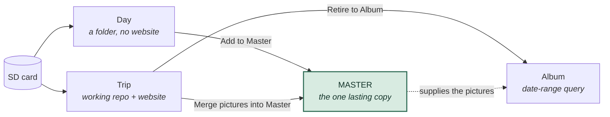

# Concepts

## What SpeciesViewer is

SpeciesViewer is a desktop program for nature photographers who think in
species, not in folders. It takes you from a full memory card to a lasting
collection: cull and identify your pictures, keep the best of every species in
one collection, write up your trips, and show it all as a website — on your own
computer, or on a web server for everyone.

It works for birds, but just as well for plants, fungi, insects, dragonflies and
mammals: every picture is tied to a species name, following the scientific
classification, in English, Dutch or the scientific name.

### Where it fits next to your other programs

Most photo software organises pictures by **folder, date and keyword**. That
suits most photography, but a nature photographer's real questions are about
species: *Which species did I see on this trip? Which are new? What is my best
picture of a Hoopoe, across twenty years? Which species do I still lack a good
picture of?* Answering those with keywords and folders is handwork.
SpeciesViewer answers them because the species *is* how it organises.

For the road from memory card to species collection, SpeciesViewer does the
work itself, in one program: reading the card, culling, rating, naming the
species, placing pictures on the map. It shows a picture fast from the JPG the
camera embeds in the RAW, or decodes the RAW itself for a sharp look at 100%.
For this work you no longer need Photo Mechanic or Lightroom's library. Only
developing the RAW into the best possible JPG stays with a program made for it.

| Program | What it is best at | What SpeciesViewer does |
|---|---|---|
| **Photo Mechanic** | Fast ingest and culling of a card; captions and keywords | Reads the card and culls just as fast, but per species: the names come from a world species list, not from free keywords. |
| **Lightroom Classic** | A catalog of folders, collections and keywords; maps; developing | Takes over the catalog and map work for your nature pictures. It reads and writes the same `.xmp` sidecars, so ratings and colour labels stay in step if you keep using Lightroom. |
| **DxO PhotoLab** | The best JPG from a (noisy) RAW | Makes plain JPGs itself, but uses PhotoLab's when they exist, and keeps PhotoLab's `.dop` sidecars in step. |

What SpeciesViewer adds that none of them has: the species and the best picture
of each, the counts and new species per trip, the trip written up day by day
with its maps, and the website built from all of it.

SpeciesViewer is **open source** (GPL-3): free to use, and anyone can read the
code or add what they need.

<small>Photo Mechanic is a trademark of Camera Bits, Inc. Adobe and Lightroom are
trademarks of Adobe Inc. DxO and PhotoLab are trademarks of DxO Labs.
SpeciesViewer is independent of these companies and not endorsed by them.</small>

Your collection stays **plain folders and files**: pictures, their
sidecars, and lists you can open in a spreadsheet. Nothing is locked inside a
catalog that only SpeciesViewer can read.

> The same story at a lower level — the physical repositories, the copy gates
> and the delete arrow — is [Appendix C](appendix-c-data-architecture.md).

## How SpeciesViewer is organised

Everything in SpeciesViewer happens inside one of four **scopes**. Almost every
question of the form *"why can't I click that?"* or *"where did my pictures
go?"* is really a question about which scope you are in and what that scope
owns. Learn these four and the menus stop being arbitrary.

---

## The four scopes at a glance

| Scope | Lives in | Owns pictures? | Has a website? | Lifetime |
|---|---|---|---|---|
| **Day** | any `YYYY-MM-DD` folder you point at | The originals, in place | No | As long as you want; it is just a folder you registered |
| **Trip** | `…\trips\<name>db` | Only the published JPGs; the RAWs you cull live in a separate `CurrentPictures` folder | Yes — `/trips/<slug>` | The working area until its pictures are in the master and an album has taken over; then retired |
| **Master** | `…\naturedb` | **Yes — the permanent store** | Yes — `/nature` | Permanent |
| **Album** | `…\virttrips\<name>` | None — its pages are built from the master | Yes — `/trips/<slug>` | Permanent, cheap |

The website is part of SpeciesViewer, not an extra. You choose where it lives:
**on this computer** — shown in your browser, nothing uploaded, and you look at
it when you want — or **on a web server**, for everyone. See
[File ▸ Settings ▸ Global](01-file.md#global).

The single most important sentence in this manual:

> **The Master is the only copy that lasts.** The trip repository is scaffolding,
> the album is a query, and the local working files get deleted on purpose once
> the master physically holds them. If something must survive, it must be in the
> master.


---

## Day

A **Day** is one date's folder of pictures, registered in a list so the
application can find it again. Nothing more. There is no repository, no
metadata tree, no blog and no website.

Use a Day for the local outing: a birding morning where you shot 300 frames, or
a targeted trip to one site after one species. You want to cull, identify what is
in the pictures, and put the keepers in the master. Building a whole trip for
that would be ceremony with no payoff.

The Day lane is deliberately short: **register or copy in → review & rate →
Add to Master**. That is the whole life of a Day. See [Chapter 3](03-days.md).

A Day is *not* a step on the way to a Trip. It is a parallel, lighter route to
the same destination (the master). Adding a Day to the master refreshes the
master website exactly as a trip merge would — new species appear, and a
better-rated picture replaces a weaker one for a species you already had.

You may well prefer this lighter approach for most of your photography. The one
thing it does not give you is a written-up journey: no per-day blog, and no trip
overview page listing the species you saw.

## Trip

A **Trip** is a working repository — a folder like `kretadb` holding metadata,
per-day review data, blog drafts, and copies of the pictures that make it onto
the trip website. It is the only scope with the full per-day **pipeline**:

```
1. Read & Summarize  →  2. Write Blog  →  3. Publish Day
```

run once per day of the trip, then, across the whole trip:

```
4. Make the Blogs Clickable  →  5. Manage Trip Publication
```

A trip is a **safe workspace**. You can cull, organise and lay out a journey
freely, and nothing you do there can reach the master.

A published day is locked. To change it — a species name, a picture, a blog —
**reset** the trip: the days are unlocked, your blog texts and the trip's species
list are kept, and you can make different choices. The website stays as it was
until you publish the days again.

When the trip's organisation and story are the way you want them, you move its pictures into the
master; its blogs and species list migrate to an **Album** automatically, keeping
the same web address, and the working repository — its job done — is retired.

Two roots matter and are easy to confuse:

- The **trip repository** (`…\trips\kretadb`) — metadata, per-day review data and
  website files: the bookkeeping that drives the culling and builds the trip site.
- The **picture root** (`D:\CurrentPictures\2026\2026 Crete`) — the actual RAW
  files you are culling, one `YYYY-MM-DD` folder per day. It is not part of the
  repository.

SpeciesViewer deletes files in the picture root in only two cases:

1. **The frames you reject** while culling. They go to a `.trash` folder beside
   the day folders, and [Trips ▸ Trash](04-trips.md) can put them back.
2. **At the very end**, the originals the master holds a confirmed copy of
   ([Delete Local Files](05-to-master.md)) — never before.

Pictures that show no species — holiday and people pictures — are not copied to
the master, so they are never deleted: they stay in the picture root. Landscapes
*are* copied to the master, so the last step deletes them here too.

## Master

The **Master** (`naturedb`) is your collection: every species you have
photographed, across every trip, good shots and mediocre ones alike, plus the
canonical CSVs that hold the biological knowledge — the species list, the
translations, the per-picture metadata.

It is fed mainly **through a trip**. The to-master step takes everything the trip
has selected — identified species and landscapes, RAW files and their JPG renders
alike — copies it into the master, and updates the master website. **Days feed the
master the same way**, just without the trip's blog and index steps.

Two more doors do the same job without any trip: **Days ▸ Add to Master**, and
**Master ▸ Add Pictures to Master**.

> **Add Pictures to Master is more powerful than its name suggests.** It ingests
> any folder — or a dragged pool of files — straight into the master, running the
> pipeline against an ephemeral micro-trip. Between it and the master's own
> website build, you can grow a complete species website without ever creating a
> trip.

**More than one master.** One computer can hold several masters — one for birds
and one for plants, or a test master to try things in. Each has its own settings,
species list, trips and albums, so working in one never touches another. One of
them is your *main* master; another one shows its name in the window title.
Switch, create and remove them under [Master ▸ Masters](06-master.md#masters).

## Album

An **Album** is a **saved date range over the master**. It holds its settings,
blog texts and a cover picture — and *no pictures of its own*. When its website
is built, the pages are made from the master's pictures in that range.

That is what makes albums cheap and safe: nothing is copied back into the
master, an album can be deleted and rebuilt, and each time its website is built
it shows the master as it is then.

What an album *does* own is its blog texts and cover picture. Those live in the
album folder, so deleting the album removes them too — the pictures themselves,
held by the master, are safe.

Albums arrive two ways:

1. **Retiring a trip** — the trip's name, dates and texts become an album, its
   blogs migrate across, and the `/trips/<slug>` website carries on being served,
   now generated from the master.
2. **Retroactively** — pick a date range in the master for a journey that never
   had a trip repository (an old holiday, say) and write it up from scratch.
   This is also how outings added with **Days ▸ Add to Master** get blogs and
   pages: make an album over their dates.

---

## Species and their names

Every picture is filed under a **species**, and every species has a scientific
name, an English name and a Dutch name. The list of them belongs to the master:
a new master starts with SpeciesViewer's starter list — birds and mammals in the
order of the world lists — and learns each new species you name.

A few rules hold everywhere — in the viewers, the counts and on the website:

- **Order follows the species list**, not the alphabet, so related species sit
  together.
- **A subspecies counts as its species.** It is shown right after the species.
- **Only a certain identification counts.** A picture marked *probable* ("cf.")
  or *possible* ("?"), or named only to a group ("*Oplurus* sp."), is kept and
  shown, but adds no species to any total until you settle it.
- **Local names travel.** When a guide calls a bird by a local name, teach it
  once ("Local name…"); from then on the name finds the species, on every
  computer the trip goes to.
- **A landscape** is not a species: it is marked as a landscape and filed
  separately.

How to do each of these is in [10. The viewers](10-viewers.md#naming-a-picture).

---

## How the four fit together

The normal life of a serious trip runs left to right. Each arrow is a real menu
action, not a metaphor.



Retiring a trip to an album is the normal end of the journey (the solid
`Trip → Album` line); the album then draws its pictures from the master every
time its site is built (the dotted line).

The full lifecycle, with the menu that owns each stage:

| Stage | Scope | Menu | What happens |
|---|---|---|---|
| 1. Get pictures in | Trip + Day | [Trips ▸ Read SD-card or Folder](04-trips.md), [Days ▸ Copy from Card](03-days.md) | Card to local `YYYY-MM-DD` folders |
| 2. Cull and identify | Trip + Day | Viewers, per day | Ratings, colour labels, species names, GPS |
| 3. Publish each day | Trip only | [Trips](04-trips.md) 1-3 | Read & Summarize, Write Blog, Publish Day |
| 4. Finish the trip site | Trip only | [Trips](04-trips.md) 4-5 | Clickable blogs, list the trip on the site |
| 5. Merge into the master | Trip + Day | [To Master](05-to-master.md), [Days ▸ Add to Master](03-days.md) | Species names, then the pictures; the master website refreshes |
| 6. Retire to an album | Trip only | [To Master](05-to-master.md) | The website carries on, now from the master |
| 7. Reclaim the space | Trip only | [To Master](05-to-master.md) | Delete local files, then the trip repo |

Steps 6 and 7 are independent once step 5 is done. Doing 6 first is the calmer
order: the reporting is in place before anything gets deleted.

Step 7 is cleaning up, not a road pictures travel, so it has no arrow in the
picture: by then the master holds the pictures and the album holds the story.

---

## The Unfiled inbox

A fifth thing, not quite a scope: **Unfiled** is a folder
(`<CurrentPictures>\<year>\<year> unfiled\YYYY-MM-DD`) holding days that have
been read off a card but not yet assigned to a trip.

It exists because "which trip is this?" is a bad question to be asked while you
are standing over a stack of cards wanting them emptied. Read them all into
Unfiled now, decide later.

> **SpeciesViewer never deletes an unfiled day.** The inbox has exits, not a
> bin: file it under a trip, claim it as a Day, or leave it be.

How to read a card into Unfiled and empty it again is in
[Utilities](08-utilities.md).
