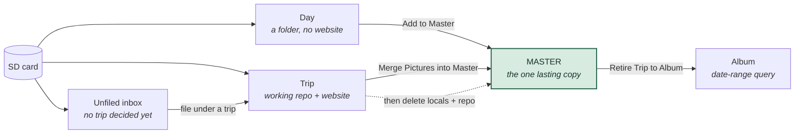

# Concepts

> The same story at a lower level — the physical repositories, the copy gates
> and the delete arrow — is [Appendix C](appendix-c-data-architecture.md).

Everything in SpeciesViewer happens inside one of four **scopes**. Almost every
question of the form *"why can't I click that?"* or *"where did my pictures
go?"* is really a question about which scope you are in and what that scope
owns. Learn these four and the menus stop being arbitrary.

---

## The four scopes at a glance

| Scope | Lives in | Owns pictures? | Has a website? | Lifetime |
|---|---|---|---|---|
| **Day** | any `YYYY-MM-DD` folder you point at | The originals, in place | No | As long as you want; it is just a folder you registered |
| **Trip** | `…\trips\<name>db` | A **copy** of the developed species pictures | Yes — `/trips/<slug>` | **Transient.** Retired once the master has it |
| **Master** | `…\naturedb` | **Yes — the one copy that lasts** | Yes — `/nature` | Permanent |
| **Album** | `…\virttrips\<name>` | **No pictures at all** | Yes — `/trips/<slug>` | Permanent, cheap |

The single most important sentence in this manual:

> **The Master is the only copy that lasts.** The trip repository is scaffolding,
> the album is a query, and the local working files get deleted on purpose once
> the master physically holds them. If something must survive, it must be in the
> master.

---

## Day

A **Day** is one date's folder of pictures, registered in a list so the
application can find it again. Nothing more. There is no repository, no
metadata tree, no blog and no website.

Use a Day for the local birding afternoon: you shot 300 frames, you want to
cull them, identify what is in them, and put the keepers in the master. Building
a whole trip for that would be ceremony with no payoff.

The Day lane is deliberately short: **register or copy in → review & rate →
Add to Master**. That is the whole life of a Day. See [Chapter 3](03-days.md).

A Day is *not* a step on the way to a Trip. It is a parallel, lighter route to
the same destination (the master).

## Trip

A **Trip** is a working repository — a folder like `kretadb` holding metadata,
per-day review data, blog drafts, and copies of the pictures that make it onto
the trip website. It is the only scope with the full per-day **pipeline**:

```
1. Read & Summarize  →  2. Write Blog  →  3. Publish Day
```

run once per day of the trip, then, across the whole trip:

```
4. Make the Blogs Clickable  →  5. Manage Trip Publication
```

A trip is **transient by design**. It exists to get a set of days identified,
written up and published while you are still travelling or freshly home. Once
its pictures are merged into the master, the trip repository is dead weight and
gets retired to an Album and deleted. This surprises people, so to be explicit:
deleting a trip is a *normal, intended* end of life, not a failure.

Two roots matter and are easy to confuse:

- The **trip repository** (`…\trips\kretadb`) — metadata and website files.
- The **picture root** (`D:\CurrentPictures\2026\2026 Crete`) — the actual RAW
  files you are culling, one `YYYY-MM-DD` folder per day.

## Master

The **Master** (`naturedb`) is your collection: every species you have
photographed, across every trip, good shots and mediocre ones alike, plus the
canonical CSVs that hold the biological knowledge — the species list, the
translations, the per-picture metadata.

It is fed from **two** directions, which is worth knowing because it explains why
"merge" is not one simple copy:

1. Via a trip — the *developed* pictures (the ones that got a JPG render) come
   across from the trip's frozen metadata.
2. Straight from local — the *undeveloped* RAWs of identified species come
   across directly, bypassing the trip repo.

And through two more doors that skip trips entirely: **Days ▸ Add to Master**,
and **Master ▸ Add Pictures to Master**.

> **Add Pictures to Master is more powerful than its name suggests.** It ingests
> any folder — or a dragged pool of files — straight into the master, running the
> pipeline against an ephemeral micro-trip. Between it and the master's own
> website build, you can grow a complete species website without ever creating a
> trip.

## Album (called `virttrip` in the code)

An **Album** is a **live date-range query over the master**. It holds an `.ini`
file, blog texts and a cover picture — and *no pictures of its own*. When its
website is built, the pages are rendered from the master's files.

That is what makes albums cheap and safe: nothing is copied back into the
master, an album can be deleted and rebuilt, and its content updates itself when
the underlying master pictures change.

Albums arrive two ways:

1. **Retiring a trip** — the trip's name, dates and texts become an album, its
   blogs migrate across, and the `/trips/<slug>` website carries on being served,
   now generated from the master.
2. **Retroactively** — pick a date range in the master for a journey that never
   had a trip repository (an old holiday, say) and write it up from scratch.

> **Naming note.** The GUI says *Album* everywhere; the code, config keys and
> folder names still say `virttrip`. Same thing. You will see `virttrips\` on
> disk and `[virttrip]` in `svconfig.ini`.

---

## How the four fit together

The normal life of a serious trip runs left to right. Each arrow is a real menu
action, not a metaphor.



The full lifecycle, with the menu that owns each stage:

| Stage | Menu | What happens |
|---|---|---|
| 1. Get pictures in | [Trips](04-trips.md) / [Utilities](08-utilities.md) / [Days](03-days.md) | Card to local folders |
| 2. Cull and identify | Viewers, per day | Ratings, colour labels, species names, GPS |
| 3. Publish each day | [Trips](04-trips.md) 1-3 | Read & Summarize, Write Blog, Publish Day |
| 4. Finish the trip site | [Trips](04-trips.md) 4-5 | Clickable blogs, list the trip on the site |
| 5. Merge into the master | [To Master](05-to-master.md) | Species names, then the pictures |
| 6. Retire to an album | [To Master](05-to-master.md) | The website carries on, now from the master |
| 7. Reclaim the space | [To Master](05-to-master.md) | Delete local files, then the trip repo |

Steps 6 and 7 are independent once step 5 is done. Doing 6 first is the calmer
order: the reporting is in place before anything gets deleted.

---

## The Unfiled inbox

A fifth thing, not quite a scope: **Unfiled** is a folder
(`<CurrentPictures>\<year>\<year> unfiled\YYYY-MM-DD`) holding days that have
been read off a card but not yet assigned to a trip.

It exists because "which trip is this?" is a bad question to be asked while you
are standing over a stack of cards wanting them emptied. Read them all into
Unfiled now, decide later.

> **SpeciesViewer never deletes an unfiled day.** The inbox has exits, not a
> bin: file it under a trip, claim it as a Day, or move it yourself.

## The main window

The window has three regions:

- **The mode strip** (left) — four pills: **Unfiled · Day · Trip · Album**. Left
  to right, this is the order pictures actually travel. The strip is the master
  control: whichever mode is selected, the rest of the window follows.
- **The left column** — the list for that mode: unfiled days, registered days,
  the trips you have, or your albums. Clicking an entry makes it the *active*
  one, and a great many menu items are enabled or greyed out purely on the
  strength of what is active here.
- **The yellow panel** (right) — a table of the active thing's contents, one row
  per day, with a column per pipeline step. This is where most day-by-day work
  actually happens: right-click a row for its actions, or run a whole column.

> **The invariant:** the left column leads. The yellow panel always shows the
> scope the mode strip is on.

Two habits that pay off immediately:

- **Right-click everything.** Rows in the yellow panel and entries in the left
  column carry context menus with actions that have no menu-bar equivalent.
- **Watch the bubbles** in the pipeline columns — they tell you which steps a day
  has been through, and hovering explains why a step is not yet available.

---

## A note on "active"

Many menu items depend on there being an **active trip**, **active album**, or
**active day**. Active means *selected in the left column* (and stored in the
config, so it survives a restart). If a whole run of menu items looks dead, the
usual cause is that nothing is active in the scope they belong to — see
[Appendix A](appendix-a-greyed-out.md).
