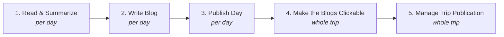

# 4. Trips

The largest menu, because a trip is the scope with the most life in it. It is
organised in six blocks, separated by dividers:

1. **Getting a trip** — create, select, or carry one between machines
2. **Getting pictures in** — read cards, empty cards
3. **Getting external edits in** — sync Lightroom and PhotoLab metadata
4. **The pipeline** — the numbered steps 1 to 5, the heart of the menu
5. **Reviewing and editing the trip** — viewers, species list, counts
6. **Advanced** — Reset Trip, rare maintenance, and the old individual pipeline steps

| Item | Shortcut | Needs |
|---|---|---|
| Select or Update Trip… | | |
| Create Trip | | |
| Export Trip | | An active trip |
| Import Trip | | |
| Read Metadata from SV INDEX Card | | An active trip |
| Read SD-card or Folder | | |
| Empty a Card | | An active trip |
| Sync Lightroom & PhotoLab Metadata | | An active trip |
| 1. Read & Summarize | `Ctrl+D` | An active trip, and the step's turn |
| 2. Write Blog | | An active trip, and the step's turn |
| 3. Publish Day | | An active trip, and the step's turn |
| 4. Make the Blogs Clickable | | At least one published day |
| 5. Manage Trip Publication… | | An active trip |
| Trip Species Viewer | | An active trip |
| Edit Species List | | An active trip |
| Publish Species Names | | An active trip **and** a master |
| Count Species | | An active trip |
| Trash (deleted pictures)… | | An active trip |
| Advanced ▸ … | | (see below) |

---

## The Trip panel

With the **Trip** pill selected, the table on the right shows the active trip,
one row per day folder. This is where a trip is worked on day by day; the menu
does the same things one step at a time.

| Column | Shows | Double-click |
|---|---|---|
| **Day** | The day folder | |
| **Pictures** | Pictures, and a health mark: ✅ all species fine · ⚠️ species name typos · 🔒 a species whose location is hidden on the website | Open the day's pictures |
| **JPEG Files** | How many developed JPGs | Open the day's JPGs |
| **GPS** | ✅ every picture has GPS · 📍 *n* pictures without | |
| **Geotag 🛰️** | Bright: a tracklog was found for the day. Dimmed: none found | Fill missing GPS and altitude from the tracklog; with none found, the window opens so you can choose a log yourself |
| **Sync Sidecars** | | Bring PhotoLab's and Lightroom's crop and exposure in step for the day — see [Sync Lightroom & PhotoLab Metadata](#sync-lightroom--photolab-metadata) |
| **In Blog** | A tick: does this day get a blog? Untick a day (the phone pictures, say) to leave it out | |
| **1 Read & Summarize · 2 Write Blog · 3 Publish Day** | The pipeline, one sphere per step (below) | Run that step for the day |
| **Translations** | 🟢 all texts checked · 🔵 *n* still to check | |
| **Metadata backup 💾** | Whether the day's work (sidecars, JPGs, blog text) is on the SV INDEX card, and whether it changed since | Back up the day's work |
| **RAW backup 💿** | Whether the day's pictures are copied to a spare card or disk | Copy the day's pictures |

The pipeline spheres:

| Sphere | Means |
|---|---|
| ⚪ | Not yet possible — hover to see what must happen first |
| 🔘 | Ready — double-click to run |
| ✅ | Done |
| 🔒 | Done, and the day is published (locked) |
| 🚫 | Ran, but there was nothing to make (no species, or no JPGs for a blog) |
| ❌ | Failed — hover for the reason |

Double-click a **column header** to run that step for every day that is ready.
Double-click a **row number** to run again every step that day has already done
(after you changed pictures, say). Right-click selected
cells for more.

Above the table:

- **🗺 Map whole trip** — every picture of the trip on one map.
- **Edit Blogs** — the blog texts of all days in one editor.
- **Write All Blogs** — step 2 for every day that is ready.
- **Publish Trip** — step 3 for every day that is ready.
- **Reset Trip** — unlock all published days, see [Reset Trip](#reset-trip--unlock-the-published-days).

After a step, if a day lies outside the trip's dates, SpeciesViewer asks once
whether to widen the dates to include it. A planned range that is wider than the
days is never questioned.

## Getting a trip

### Select or Update Trip…

Switches to another trip, or changes the current one's dates, texts and pictures
folder. It loads the trip you pick and can only write back into that one.

### Create Trip

Create Trip is where you set the two things that stay fixed for the life of the
trip — its **web address** and its **picture directory** — and scaffold the
repository (the `sv1MakeRepository` batch). Everything else (dates, titles, blog
text) you change later with *Select or Update*, which deliberately does not offer
the scaffold button.

In practice you often create a trip *before* you travel — placeholder dates, a
stub blog, no pictures yet — and let it fill in as the journey happens.

**One name, the rest suggested.** The first tab, *Name & Folders*, asks for a
trip name and the dates. From the name `Spain`, starting in 2026, it suggests:

| What | Suggested | |
|---|---|---|
| SpeciesViewer's files | `<Trips folder>\spaindb` | the trip's own data and web pages |
| Your pictures | `<Pictures folder>\2026\2026 Spain` | the day folders go inside |
| Web address | `…/trips/spain` | lowercase, accents dropped, spaces become `-` |

The year is the trip's **start** year, not today's. Each folder follows the name
until you change it; **↺** brings the suggestion back. Each line says what will
happen: *will be created*, *⚠ exists, 3 day folders — this trip will use them*
(a pictures folder often exists first, when the card was copied before the trip
was made), or a red ✗ that blocks Create:

- the folder for SpeciesViewer's files already holds something;
- the web name is already used — by a trip folder, an album, or a trip on your
  website's trip list. The message says which. A web address can never change
  later, so this is checked before anything is made.

**Check Range…** sits beside the dates: what the master already holds for them,
and which trips or albums overlap (never the trip itself).

**Create Trip** makes both folders, copies the default trip picture and banner
into the trip (replace them later on the *Images* tab), sets both titles to the
name, and builds the trip. Afterwards the button reads *Created ✓*.

The descriptions on *Trip Text* take links: **Ctrl+K** or right-click ▸
*Insert link…*.

> **Why Create and Select are two items.** *Create Trip* makes a new trip and
> fixes the two things that can never change afterwards: its **web address**
> and its **folders**. *Select or Update Trip* never makes a trip; it opens one
> you have and lets you change everything else — dates, titles, texts,
> pictures. So creating a new trip can never touch the trip you have open.

### Export Trip

*Needs: an active trip.*

Zips the trip's **settings, species list and translations** — its identity, not
its pictures. Small.

This is half of carrying a trip to another machine: prepare it on the big
machine, export, import on the laptop.

### Import Trip

Brings a trip home from another computer, in one window with three numbered
steps. The top of the window shows all three steps with their status, so you
can see at any moment what is done and what is left.

| Step | Brings back | From |
|---|---|---|
| **1 Trip** | The trip's settings, banner and trip picture, species list, local names, lifer status and translations | The trip ZIP on the SV INDEX card, or any trip ZIP (Export Trip) |
| **2 Metadata** | Per day: culling colours, species names, locations, crops, blog text and the rendered JPGs; the GPS tracklogs | The day backups on the SV INDEX card |
| **3 Pictures** | The RAW pictures | The trip's SD-cards, or a folder they were dumped into |

Steps 2 and 3 work in either order, and can be repeated as often as you like.

**Step 1.** Choose the SV INDEX card. The trips on it are listed, newest first,
with whether each one is already on this computer. Pick one and press *Import*.
Importing a trip that is already here is safe: the species list and translations
are merged, and the files replaced go to the trip's `.trash` folder.

**Step 2 — newer wins.** The day list fills itself as soon as the card matches
the open trip. For each day it shows:

| Column | Means | What happens |
|---|---|---|
| New | Not on this computer yet | Added |
| Newer on the card | Differs, and the card's copy is later | Taken; the copy here is kept in the trip's `.trash/replaced` folder |
| Newer here | Differs, and the copy here is later | **Never overwritten** — only counted |
| Same | Identical | Skipped |

Files of pictures you have deleted on this computer are not brought back. The
tick on a day is the confirmation; there is no question per file. *Details of a
day…* lists the files behind the numbers, read-only. Days that are on this
computer but not on the card are shown greyed: their pictures can only come
from a card or dump.

**Step 3.** *Read from* shows the SD-card or dump folder the pictures come
from, and what it was last read into; *Choose…* changes it. Each day shows how
many of the pictures kept on the trip are here ("520 of 751"), and which card or
dump it was last read from. *Read SD-card or Folder…* opens the card read with
that source, and the trip's folder, name prefix and date folders filled in and
locked, and scans the days at once; you choose which days to read. Pictures
culled on the trip are left out, and so are pictures you deleted on this
computer since (they are in the trip's trash). Per day, *To copy* says how many
pictures a Read would add, and *Metadata on this source* how the sidecars and
rendered JPGs there compare with the ones here. Only days with something to
copy, or with newer metadata, start ticked.

Newer wins here too: a sidecar or a rendered JPG (PhotoLab's `_DxO` files) on the
card or dump that is newer than the one here replaces it, and the older one is
kept in `.trash/replaced`. An older one is left alone. A camera's own JPG is
never replaced: a different picture under the same name is a new shot, and is
saved beside it with a letter added (`… B.JPG`).

> 💡 **Tip.** If the pictures are already on a disk (copied off the laptop, say),
> point *Read SD-card or Folder…* at that folder instead of a card — the same
> rules apply.

### Read Metadata from SV INDEX Card

*Needs: an active trip.*

Opens the Import Trip window at step 2, for reading the SV INDEX card on its
own — after a trip, or on the same computer.

The SV INDEX card is the card you write while travelling (click the *Metadata
backup* cell of a day in the Trip Overview). You choose the card itself, never
a trip folder on it: the backup adds the trip's folder by itself. If you do
pick a trip folder, SpeciesViewer says so and offers the card instead. The RAW
backup follows the same rule, so both can share one card.

---

## Getting pictures in

### Read SD-card or Folder

Copies pictures from a folder — typically a mounted card — into the trip's
picture folder, one `YYYY-MM-DD` folder per day. It needs no trip steps to have
run: it happens before there is anything to run them on.

**Scan days** first. The table lists every day on the card:

| Column | Means |
|---|---|
| **Files** | Pictures on the card for that day |
| **Copied** | How many are already here (✓ when all are) |
| **Tracklog** | Whether a GPS log for the day was found |

Two more columns appear only when you read a card **again** for a trip whose
backup covers those days — on another computer, or after a trip:
**Deleted** (pictures you deleted while culling; they are not copied back) and
**Kept** (the ones a re-read copies back). Read for a trip from Import Trip, it
also shows **To copy** and **Metadata on this source**.

Tick the days to copy, then **Read**. Alongside the pictures it carries the
sidecars it finds (`.xmp`, `.dop`).

What it tells you on the way:

- **The camera's clock in another time zone.** When the pictures and the day's
  tracklog disagree about the time zone, an orange box says so and sets the time
  zone offset for you, so the pictures land in the right day folder. Positions
  are not affected.
- **Files it leaves behind.** Files that are not pictures (`.log`, `.zip`, …) are
  counted under the table. Pictures in a format SpeciesViewer cannot read yet
  (Canon `.HIF`, Pentax `.PEF`, Samsung `.SRW`) are named as pictures, with the
  folder they are in, and with the advice not to format the card.
- **Whether everything arrived.** The read ends with "✅ All N picture(s) from
  this card for the chosen days are here", or "⚠️ Only n of N …" — then keep the
  card and read it again.
- **Not enough room.** Before copying anything it checks the free space on the
  destination; if it is short, nothing is copied.

Once read, **View pictures** opens the new pictures, **Open day in PhotoLab**
hands a day to PhotoLab, and **Geotag from tracklog…** fills missing GPS.

> **The other lane.** If you do not yet know which trip a card belongs to, use
> [Utilities ▸ Read card into unfiled…](08-utilities.md) instead. It asks nothing
> and claims nothing; later you file each day under a trip or claim it as a Day.

> 💡 **Tip.** A flat folder of mixed dates — an old shoot, a batch someone sent
> you, a set of pictures ordered by day — goes into the master through
> *Master ▸ Add Pictures to Master* (add an Album for the date range if you want
> a page for it). The card reader is for cards, not for folders like these.

### Empty a Card

*Needs: an active trip.*

The other end of Read SD-card or Folder. When every picture on a card has been
judged, this checks that is actually true, saves the **keepers** to a second
card, and marks the original safe to format. SpeciesViewer never formats a card
itself — do that in the camera.

1. **Check card** — every picture on the card gets a verdict: kept, marked for
   deletion, or already gone. Anything not settled is listed under *Needs
   attention* — a picture with no colour yet, for instance. **Deal with these
   here…** opens just those pictures.
2. **Save the keepers…** — copies the kept pictures (with their sidecars) to the
   keeper card or folder, checks the copies, and only then writes on the card
   that it is safe to format.
3. **Delete from the card…** — a separate step, offered only after the copies
   are verified. It asks first, and says how many pictures were thrown away
   during culling and will then exist nowhere. Files SpeciesViewer does not know
   are never touched.

A card is **not** declared safe when SpeciesViewer never read it (it carries no
record of what was on it), or when it holds pictures SpeciesViewer cannot read
(such as Canon `.HIF`).

It needs the trip because the verdicts live beside the trip's pictures. The name
written onto the physical card is the **picture folder's** name (`2026 North
Greece`), not the repository id (`greecedb`) — so it matches the filename prefix
on everything inside it when you read it back months later.

---

## Getting external edits in

### Sync Lightroom & PhotoLab Metadata

*Needs: an active trip.*

Compares, picture by picture, the crop and exposure in PhotoLab's `.dop` and
Lightroom's `.xmp`, and brings them in step:

- only one of the two has an edit → it is copied to the other;
- both have one → the newer file wins;
- neither has one → nothing happens.

It ends by saying what to do next, for example *"Synced DOP→XMP: 16 file(s) →
reload metadata in Lightroom"* and *"Synced XMP→DOP: 2 file(s) → read sidecars
in PhotoLab"*, because neither program notices on its own that a sidecar
changed.

Run it after a development session, before Read & Summarize. It covers crop and
exposure only — not the full development recipe. Also the *Sync Sidecars* column
of the Trip panel, for one day.

---

## The pipeline

The five numbered steps are the trip's publishing cycle. **Steps 1 to 3 run per
day.** Steps 4 and 5 act on the *whole trip* and are re-run on each publishing
pass.

> **You will usually run 1 to 3 from the [Trip panel](#the-trip-panel), not this
> menu.** The menu acts on the day you have selected; the panel lets you see all days at
> once, run a whole column, and see which step each day has reached. The menu
> entries exist for when you want to ask for a step by name.

Each step unlocks only when the one before it has run for that day. A greyed step
means its predecessor is still pending — hover it and the tooltip says which.

### 1. Read & Summarize — `Ctrl+D`

Reads the day's pictures (EXIF, sidecars, species names) and writes the day's
summary data.

This is the step that turns "a folder of files" into "a day the application
understands". Re-run it any time; it is not destructive.

> If you change a species name anywhere, you will be offered a re-summarize of
> all days, because the name has to reach the pipeline to show up on the site.

### 2. Write Blog

Generates the day's blog entry from its species and pictures — a draft you then
edit. Re-run it whenever you like: after identifying more species, or to pick up
a rewritten introduction. It stays available after the day is published.

SpeciesViewer chooses the pictures by rating: per species the best one (and one
each for male, female and juvenile where those are marked). In the blog's
*Configuration* you can set:

- **Pictures per species** — 1 to 20; the best-rated ones, in the order taken.
- **The picture for the blog index** — which of the day's pictures stands for
  the day on the trip's blog index, or *Automatic (highest rated)*.
- A minimum rating, to keep the blog to your best frames only.

In the blog text, **Ctrl+K** inserts or edits a link. Links survive translation.

### 3. Publish Day

Makes the day's data final, builds the day's website pages and puts them on
the website. The final data is also what the master merge reads from later. The step ends with the result: how many species
the trip has, how many are new this day, and how many have a picture on the trip
website.

Before copying anything it checks that the trip's drive has room; if not, it
stops with nothing copied.

A published day is locked (🔒) and cannot be re-run on its own; only its blog
can still be rewritten. If you need to bring in more pictures afterwards,
[Reset Trip](#reset-trip--unlock-the-published-days) frees all the days again so you can re-publish from a clean state.
Because of that, publish a day only when you are fairly sure it is complete. The
trip's species list and website come out the same in any publishing order;
a publish never lowers the number of species on the trip website. One number
does follow the order: *new this day* in the closing line counts against the
days already published. Publish in date order and it means "new on this date".

### 4. Make the Blogs Clickable

*Needs: at least one published day.*

A **required finalize step over the whole trip**, not a cosmetic extra. It adds:

- next/previous navigation links between the day blogs, and
- hyperlinks on scientific names, pointing at the species pages.

It can only do this once all the species in the trip are known, which is why it
comes after the days are published rather than during them. Re-run it whenever
you publish more days or add species.

### 5. Manage Trip Publication…

*Needs: an active trip.*

Lists this trip on the website's trip index, or removes it from there. Both
directions in one dialog.

The live index is always the base for any write — so a trip someone else's
machine published is not silently dropped.

> **The web slug is immutable once created.** Renaming a trip's display title is
> safe; its address on the site is not something that can be changed afterwards.
> See [the trip-index how-to](howto_trip_index_publication.md).
>
> A listing whose trip or album you can no longer open is repaired from
> [Master ▸ Maintain Master Database ▸ Manage Site Publication…](06-master.md).

### Reset Trip — unlock the published days

*Needs: an active trip.*

Rebuilds the trip's generated data — the per-day summaries — from the current
pictures and species, and frees the published days so the pipeline picks up
changes you have made. Also the **Reset Trip** button above the Trip panel. Open
picture windows of the trip are closed first. Your own work is kept:
hand-edited blog text and the trip species list are not touched, and
anything already published stays up. After a reset you can refresh the website.

Reset is a normal part of working on a trip, not a repair: a published day is
locked, and Reset is how you go back to it — to add pictures, change a species
name, or choose different blog pictures. Then run the steps again for the days
you changed. The menu still has it under *Advanced*.

---

## Reviewing and editing the trip

### Trip Species Viewer

*Needs: an active trip.*

The trip's editable species view: every species in the trip with its pictures,
where you can change star ratings, colour labels and the species assignment
itself, with the changes written back to the files.

This is arguably the most valuable single screen in the trip menu — it is where a
trip's identifications actually get corrected. From here you can also fix place
and time (remove a wrong GPS, set a missing date and time, move pictures to
another day of the trip) and review uncertain identifications. Its scopes,
filters and bulk actions are documented in
[10. The viewers](10-viewers.md#the-species-viewers).

> **Frozen days open read-only.** Once a day has been committed, its cards are
> not editable; this is a guard, not a bug.  After a reset, all days can be updated.

### Edit Species List

*Needs: an active trip.*

Opens the master's **species list** — scientific name with its English and
Dutch name. Use it mostly to fill in an English or Dutch name that GBIF does
not have; Wikipedia in that language is a good source. **Lookup NBA** fills in
missing English and Dutch names for the rows shown, from the Netherlands
Biodiversity API, which sometimes knows more names than GBIF.

> **There is one list per master.** This entry and [Master ▸ Edit Species
> List](06-master.md) open the same file: the master's
> `metadata/active/speciescollection.csv`.
>
> When you save, changed rows are also mirrored into the active trip's working
> copy, so the trip's own pipeline steps see the new names. If no master is
> configured, the trip's list *is* the shared list.

Changing a name offers to re-summarize all days, so the correction reaches the
website.

### Publish Species Names

*Needs: an active trip **and** a master.*

Merges the trip's species into the master's list, showing you the merge result
before anything is copied. New species found on this trip become part of the
permanent vocabulary.

This item also appears in [To Master](05-to-master.md) — it is the same action,
listed in both places because it is both "finish the trip" and "start the merge".

On a single machine this step is usually a no-op: the species list is already the
master's (see *Edit Species List* above). It matters when the trip was built on
another machine and carries names the master has not seen.

### Count Species

*Needs: an active trip.*

A table of the trip's species: one row per species, one column per day, with
the number of pictures, and a **No JPG** flag on a lifer that has no developed
picture yet. Save it as Excel or CSV. Report only.

Only certain identifications count: a "probable" or "possible" picture, or a
group name like "*Oplurus* sp.", does not add a species.

Note that Count Species is *also* the first step of the master merge, where it
runs before the pictures are ingested — that ordering is what makes the "lifer"
verdict true, because the master is still pre-trip at that moment.

### Trash (deleted pictures)…

*Needs: an active trip.*

Pictures you delete while culling are not gone: they are moved to a `.trash`
folder beside the day folders. This window shows them, one day at a time.

- **Restore selected** — puts the pictures back in their day folder. Only for a
  day that is not published. Right-click a picture to add it to the selection.
- **Discard this day** — deletes that day's trashed pictures for good, after a
  confirmation that names how many and how big.

Double-click a picture (or press `z`) for a big look.

---

## Advanced

Rare maintenance. Nothing here is part of a normal trip — except Reset Trip,
which is described with [the pipeline](#reset-trip--unlock-the-published-days).

### Manage Blogs

The delete-a-blog tool: lists the trip's blog entries and lets you remove one.

### Recreate Trip Repository

*Needs: an active trip.*

Rebuilds the trip's repository and every generated page from scratch. Heavier
than Reset. Useful after adding a few pictures or renaming species when the site
is otherwise the way you want it — and after a SpeciesViewer update that changed
how pages are built (not something that affects you day to day).

> The pictures in `CurrentPictures` are never touched by either action — only the
> data and pages the pipeline generated from them.

### Delete Trip Completely…

For a trip that never became a real one — a test, a mistake, or a copy that
now lives on your other computer. The normal end of a trip is
[To Master ▸ Retire](05-to-master.md).

The dialog lists every trip it knows — folders on this computer **and** names
on the website's trip list, so a trip whose folder is already gone can still be
removed. Pick one and tick what goes:

- **SpeciesViewer's files** — the trip's folder, with its size. A backup zip in
  `.trash` only when you tick *Keep a backup zip*.
- **The row on the trip list**, and **the published pages** `/trips/<name>/` —
  only on a computer that owns the website: a website **on this computer**, or
  a website on a server from the computer with the **full master**. On a laptop
  with a read-only copy of the master they are not offered: deleting a laptop's
  copy there would remove what your big computer published.

Never touched: your pictures (the report says where they are) and the master.
A trip of another master in the same Trips folder is shown grey — open that
master to delete it. A trip an album was made from keeps its web address and
trip-list row: they belong to the album.

### Advanced ▸ Legacy

The individual pipeline steps, from before they were merged into
*Read & Summarize* and *Publish Day*. They remain for two narrow cases: a
read-only CSV refresh, and the freeze-only edge case.

| Item | Was |
|---|---|
| **Read Directory** | The first half of Read & Summarize (`sv2`) |
| **Write Summary** | The second half of Read & Summarize (`sv3`) |
| **Freeze Data** | The first half of Publish Day (`sv6`) |
| **Write Website Commit** | The second half of Publish Day (`sv7`) |

If you are not sure you need one of these, you do not need it.
