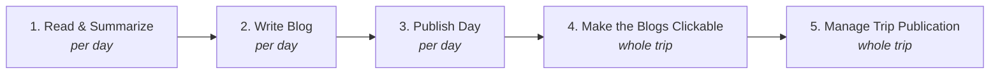

# 4. Trips

The largest menu, because a trip is the scope with the most life in it. It is
organised in five blocks, separated by dividers:

1. **Getting a trip** — create, select, or carry one between machines
2. **Getting pictures in** — read cards, empty cards
3. **Getting external edits in** — sync Lightroom and PhotoLab metadata
4. **The pipeline** — the numbered steps 1 to 5, the heart of the menu
5. **Reviewing and editing the trip** — viewers, species list, counts
6. **Advanced** — rare maintenance, and the legacy individual pipeline steps

| Item | Shortcut | Needs |
|---|---|---|
| Select or Update Trip… | | |
| Create Trip | | |
| Export Trip | | An active trip |
| Import Trip | | |
| Restore Work from Card | | An active trip |
| Read SD-cards | | |
| Empty a Card | | An active trip |
| Sync Lightroom & PhotoLab Metadata | | An active trip |
| 1. Read & Summarize | `Ctrl+D` | An active trip, and the step's turn |
| 2. Write Blog | | An active trip, and the step's turn |
| 3. Publish Day | | An active trip, and the step's turn |
| 4. Make the Blogs Clickable | | At least one published day |
| 5. Manage Trip Publication… | | An active trip |
| Trip Species Viewer | | An active trip |
| Edit Species List | | An active trip |
| Publish Species Names | | An active trip **and** a master |
| Count Species | | An active trip |
| Advanced ▸ … | | (see below) |

---

## Getting a trip

### Select or Update Trip…

Switches to another trip, or changes the current one's dates, texts and pictures
folder. It loads the trip you pick and can only write back into that one.

### Create Trip

Starts empty, and can only write into a folder it creates itself.

> **Why these are two entries and not one screen.** They used to be a single
> "Create or Select" dialog, which pre-filled its fields from the *active* trip.
> That is how a live trip's identity was once overwritten by creating a new one.
> Two dialogs, each able to write to exactly one place, removes the trap. See
> [plans/trip_dialog_and_ingest_lanes.md](../plans/trip_dialog_and_ingest_lanes.md).

Create Trip is also the step that builds the trip's repository structure — the
`sv1MakeRepository` batch. Select or Update deliberately does not offer that
button.

### Export Trip

*Needs: an active trip.*

Zips the trip's **settings, species list and translations** — its identity, not
its pictures. Small.

This is half of carrying a trip to another machine: prepare it on the big
machine, export, import on the laptop.

### Import Trip

Unpacks a trip export on this machine.

### Restore Work from Card

*Needs: an active trip.*

Import Trip's larger sibling. The trip's *identity* is only the first part of
coming home — the **culling work** is the rest, and that lives on the SV INDEX
card rather than in the trip export.

Re-reading the card re-applies the ratings, colour labels and species names you
assigned while travelling, onto the pictures in the trip you have open.

Open the trip you want to restore into **first**; the dialog needs it.

---

## Getting pictures in

### Read SD-cards

Copies pictures from a folder — typically a mounted card — into the trip's
picture directory. It runs the copy directly on a worker thread: no statemachine,
no config plumbing, because it happens *before* any day or trip structure exists
for those files.

Alongside the pictures it carries across the sidecars it finds (`.xmp`, `.dop`),
reports files it ignored, and shows a per-day count as it goes.

> **The other lane.** If you do not yet know which trip a card belongs to, use
> [Utilities ▸ Read card into unfiled…](08-utilities.md) instead. It asks nothing
> and claims nothing.
>
> **And a rule learned the hard way:** old flat folders of mixed dates should go
> in via *Add Pictures to Master* (plus an Album for the range), never through the
> card reader.

### Empty a Card

*Needs: an active trip.*

The other end of Read SD-cards. When every picture on a card has been judged, this
checks that is actually true, saves the **keepers** to a second card, and marks
the original safe to format.

It needs the trip because the verdicts live beside the trip's pictures. The name
written onto the physical card is the **picture folder's** name (`2026 North
Greece`), not the repository id (`greecedb`) — so it matches the filename prefix
on everything inside it when you read it back months later.

---

## Getting external edits in

### Sync Lightroom & PhotoLab Metadata

*Needs: an active trip.*

Reads back what Lightroom and DxO PhotoLab have written into the `.xmp` and
`.dop` sidecars, so the trip's own data agrees with what those applications
think.

Run it after a development session, before Read & Summarize — otherwise the
pipeline summarises stale metadata.

---

## The pipeline

The five numbered steps are the trip's publishing cycle. **Steps 1 to 3 run per
day.** Steps 4 and 5 act on the *whole trip* and are re-run on each publishing
pass.

> **You will usually run 1 to 3 from the yellow panel, not this menu.** The menu
> acts on the day you have selected; the yellow panel lets you see all days at
> once, run a whole column, and see which step each day has reached. The menu
> entries exist for when you want to ask for a step by name.

Each step is gated by a **statemachine**: a step is only clickable when its
predecessor has run for that day. If a step is greyed, hover it — the tooltip
explains what is missing.

### 1. Read & Summarize — `Ctrl+D`

Reads the day's picture directory (EXIF, sidecars, species names) and writes the
day's summary data. It is two historical steps in one — *Read Directory* +
*Write Summary* — merged because the EXIF cache makes re-reading cheap, so fresh
data is the sensible default.

This is the step that turns "a folder of files" into "a day the application
understands". Re-run it any time; it is not destructive.

> If you change a species name anywhere, you will be offered a re-summarize of
> all days, because the name has to reach the pipeline to show up on the site.

### 2. Write Blog

Generates the day's blog entry from its species and pictures. The result is a
draft you can then edit.

### 3. Publish Day

**Freeze** the day's data and **commit** it to the website, in one step. Freeze
also builds the website pages, which is why the old separate "Build Website" step
no longer exists.

Freezing is what makes a day's data final and quotable — it is the snapshot the
master merge later reads from.

> The individual **Freeze Data** and **Write Website Commit** steps still exist
> under *Advanced ▸ Legacy*, for the rare case where you want only one of them.

### 4. Make the Blogs Clickable

*Needs: at least one published day.*

A **required finalize step over the whole trip**, not a cosmetic extra. It adds:

- next/previous navigation links between the day blogs, and
- hyperlinks on scientific names, pointing at the species pages.

It can only do this once all the species in the trip are known, which is why it
comes after the per-day steps rather than during them. Re-run it whenever you
publish more days.

### 5. Manage Trip Publication…

*Needs: an active trip.*

Lists this trip on the website's trip index, or removes it from there. Both
directions in one dialog.

The live index is always the base for any write — so a trip someone else's
machine published is not silently dropped.

> **The web slug is immutable once created.** Renaming a trip's display title is
> safe; its address on the site is not something that can be changed afterwards.
> See [the trip-index how-to](howto_trip_index_publication.md).
>
> A listing whose trip or album you can no longer open is repaired from
> [Master ▸ Maintain Master Database ▸ Manage Site Publication…](06-master.md).

---

## Reviewing and editing the trip

### Trip Species Viewer

*Needs: an active trip.*

The trip's editable species view: every species in the trip with its pictures,
where you can change star ratings, colour labels and the species assignment
itself, with the changes written back to the files.

This is arguably the most valuable single screen in the trip menu — it is where a
trip's identifications actually get corrected. Its scopes, filters and bulk
actions are documented in
[10. The viewers](10-viewers.md#the-species-viewers).

> **Frozen days open read-only.** Once a day has been committed, its cards are
> not editable; this is a guard, not a bug.

### Edit Species List

*Needs: an active trip.*

Opens the **shared species name dictionary** — scientific name to English and
Dutch common names.

> **There is only one list.** This entry and [Master ▸ Edit Species
> List](06-master.md) open the same file: the master's
> `metadata/active/speciescollection.csv`. It used to be two lists on two files,
> and which entry you happened to open decided who saw your correction.
>
> When you save, changed rows are also mirrored into the active trip's working
> copy, so the trip's own pipeline steps see the new names. If no master is
> configured, the trip's list *is* the shared list.

Changing a name offers to re-summarize all days, so the correction reaches the
website.

### Publish Species Names

*Needs: an active trip **and** a master.*

Merges the trip's species into the master's list, showing you the merge result
before anything is copied. New species found on this trip become part of the
permanent vocabulary.

This item also appears in [To Master](05-to-master.md) — it is the same action,
listed in both places because it is both "finish the trip" and "start the merge".

### Count Species

*Needs: an active trip.*

Analyses the trip's species information and produces a report: what was seen, how
often, how it compares. Report only.

Note that Count Species is *also* the first step of the master merge, where it
runs before the pictures are ingested — that ordering is what makes the "lifer"
verdict true, because the master is still pre-trip at that moment.

---

## Advanced

Rare maintenance. Nothing here is part of a normal trip.

### Manage Blogs

The delete-a-blog tool: lists the trip's blog entries and lets you remove one.

### Reset Trip

*Needs: an active trip.*

Empties the trip's data so it can be customised again from scratch. The trip
keeps existing; its accumulated pipeline data does not.

### Recreate Trip Repository

*Needs: an active trip.*

Deletes the existing repository and rebuilds it. Heavier than Reset.

> Both of these throw away work. The pictures in `CurrentPictures` are not
> touched, but everything the pipeline built about them is.

### Advanced ▸ Legacy

The individual pipeline steps, from before they were merged into
*Read & Summarize* and *Publish Day*. They remain for two narrow cases: a
read-only CSV refresh, and the freeze-only edge case.

| Item | Was |
|---|---|
| **Read Directory** | The first half of Read & Summarize (`sv2`) |
| **Write Summary** | The second half of Read & Summarize (`sv3`) |
| **Freeze Data** | The first half of Publish Day (`sv6`) |
| **Write Website Commit** | The second half of Publish Day (`sv7`) |

If you are not sure you need one of these, you do not need it.
