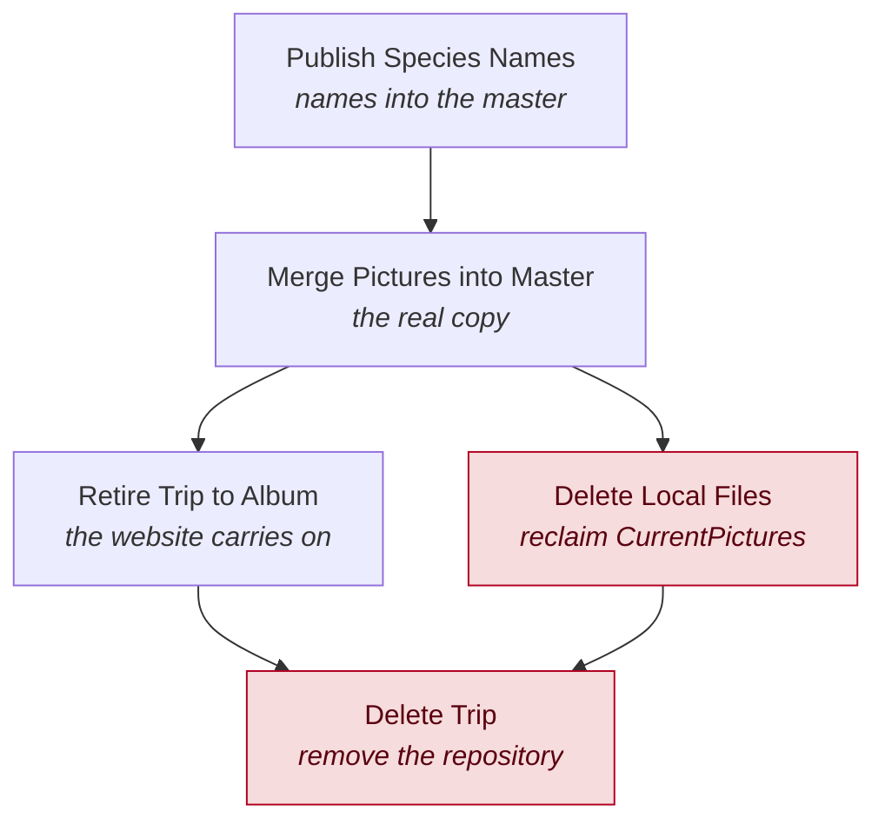

# 5. To Master

The whole "into the master" phase, in one menu: the real merge, then winding the
trip down once it lives in the master and an album.

These items used to be scattered between the Trips and Master menus. They are
gathered here because they are one arc — steps 4 to 7 of a trip's life — and
because they run in a strict order that the menu now enforces by greying out
whatever is not yet due.

| Item | Needs |
|---|---|
| Trip to Master Dashboard | An active trip |
| Publish Species Names | An active trip **and** a master |
| Merge Pictures into Master | Every JPG-bearing day published, and at least one day published |
| Retire Trip to Album | A full master, an active trip, **and** the merge done |
| Delete Local Files Backed Up in Master… | The merge done |
| Delete Trip… | The merge done **and** the trip retired |

The gating is the useful part of this menu: **you cannot get the order wrong**.
Each item unlocks only when its predecessor has genuinely happened, checked
against real evidence — a marker file the merge writes, a flag the retire stamps
into `trip.ini`, a scan of which days have been published.

---

## Trip to Master Dashboard

*Needs: an active trip.*

A board view of exactly this arc, showing four columns — **Trip**, **To Master**,
**Album**, **Clean up** — with the state of each stage and a card per action.

It is a *view over the same menu items*, not a separate mechanism: the same
gating rules apply, and clicking a card does what the menu item does. Each column
carries a gate line telling you what becomes impossible once you pass it —
"no edits possible", "no more changes", "changes now happen in the album".

The pipeline cards (Read & Summarize, Write Blog, Publish Day) deliberately do
*not* fire a batch step: they take you to the Active Trip yellow panel, because
that is where you choose which day to run. The progress bars still show how many
days each step has reached.

Use the dashboard when you want to see where a trip stands. Use the menu when you
know what you want to run.

---

## Publish Species Names

*Needs: an active trip and a master.*

Merges the trip's species list into the master's, showing you the result before
committing. Identical to the entry in [Trips](04-trips.md).

Names first, pictures second: the master should know what a species is called
before it receives pictures of it.

---

## Merge Pictures into Master

*Needs: at least one day published, and every day that has JPGs published.*

**The real merge.** Opens a four-step dialog with a *Run all* button that chains
the steps and stops on the first failure.

| Step | Does |
|---|---|
| **1. Count Species (final verdict)** | Counts the trip's species and archives the verdict — including which species were **lifers**. |
| **2. Read & Summarize** | Reads the pictures and writes their summary *into the master*. |
| **3. Build Master Website & Freeze** | Builds the master's species pages and the all-species index, then freezes. |
| **4. Commit to Master** | Commits the frozen data into the master's active CSVs. |

Two things about this dialog are worth understanding.

**Why Count Species goes first.** It runs against the *trip's* data, deliberately
without master mode, and it goes first because the master is still pre-trip at
that moment. That is what makes the lifer verdict true: a species is a lifer if
the master had no picture of it *before* this trip.

**Steps 2 to 4 run the ordinary pipeline in master mode.** The same `sv2`/`sv3`,
`sv5`/`sv6`, `sv7` code as a trip day — only the target repository differs. The
merge pulls developed files from the trip's frozen metadata *and* undeveloped
RAWs straight from local, so the master ends up holding every identified species
file, not just the ones that got a JPG render.

When it completes, a marker is written to
`<master>\admin\master_commits.csv` keyed by the trip's picture root. That marker
is what unlocks the next two items.

> **Why the gate is strict.** Merge stays greyed until every day holding JPGs has
> been published, *and* at least one day actually has been. A half-published trip
> would merge a half-collection, and the delete steps that follow would then be
> operating on a false picture of what the master holds.

---

## Retire Trip to Album

*Needs: a full master (not a SmallMaster install), an active trip, and the merge done.*

Turns the finished trip into an [Album](07-albums.md), in one action. It runs the
whole arc:

1. Create the album repository with the trip's name, date range and texts
2. Extract the album's days from the master
3. Migrate the trip's day blogs across
4. Write the album blogs
5. Build the album website
6. Make the blogs clickable
7. Add the album to the master

It also copies the trip's banner and cover picture from the trip root into the
album root, so the site keeps its imagery.

The result: `/trips/<slug>` carries on being served exactly as before — but now
generated from the master's own files. **Nothing is copied back into the master.**

It runs in a worker thread with a progress spinner and stops on the first error.
Completed steps are safe to repeat, so a failed retire can simply be re-run.

> **A rebuild of an existing album does not clear old blog pages.** If you are
> re-retiring over an album that already has pages, run *Write Album Blogs* with
> "Clear old" manually.

After this, editing happens in the album, not the trip.

---

## Delete Local Files Backed Up in Master…

*Needs: the merge done.*

Deletes the trip's local originals **that the master already physically holds**.
This is the step that reclaims the space in `CurrentPictures`.

It is driven by **ground truth**: it walks the actual files on disk under the
trip's picture root and classifies each one against the master. A file is
deletable only when a byte-identical copy is confirmed present in the master —
both its UPN and its exact filename. Files classified `keep` (not in the master)
and `held` (the species is in the master but this particular local render is not)
are never touched.

You get the full report first, and a per-file detail CSV at
`<trip>\metadata\trip_delete_dryrun.csv`. The red **"Delete N files"** button is
the confirmation; there is no other.

> **Why the paranoia.** This step once deleted about 14,000 local originals whose
> "master copy" existed only as a row in a CSV. Two faults lined up: the freeze
> wrote master rows for files it had not actually copied, and the delete decided
> what to remove by reading that list rather than looking at the disk. Both are
> fixed — the freeze now verifies its copies, and this step trusts the disk, never
> the list.

If the report mentions files kept *with a species*, those are identified pictures
the master does not have. Rescue them with **Add Pictures to Master** before
retiring the whole trip, or they stay local forever.

---

## Delete Trip…

*Needs: the merge done and the trip retired.*

Permanently deletes the trip **repository** — its metadata copy. It does *not*
touch `CurrentPictures`, the master, or the album.

It reuses the vetted retire flow: a pre-flight scan, blockers, and an explicit
confirmation. The blockers are overridable behind a checkbox, logged by name,
for legacy trips that predate the retirement flag.

Because a trip cannot be deleted while it is the active one, the dialog
**de-selects the active trip first** — clearing the trip config, repainting the
overview and rebuilding the menu into the no-trip state — and then proceeds.

This is the normal, intended end of a trip's life.
