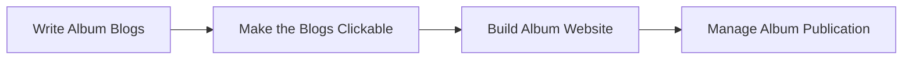

# 7. Albums

An **Album** is a live date-range query over the master. It holds no pictures —
just an `.ini`, blog texts and a cover — and its website is rendered from the
master's own files. See [Concepts](00-concepts.md#album-called-virttrip-in-the-code).

This menu mirrors the trip pipeline, minus everything to do with owning
pictures: there is no ingest, no freeze, no commit, because there is nothing to
ingest, freeze or commit. There is only writing it up and publishing it.

| Item | Needs |
|---|---|
| Find Trips in the Master… | A full master |
| Select or Update Album… | A full master |
| Create Album | A full master |
| Write Album Blogs | An active album |
| Make the Blogs Clickable | An active album |
| Build Album Website | An active album |
| Manage Album Publication… | An active album |
| Species per Day… | An active album |
| Album Species Viewer | An active album |
| Sync Placed GPS into the Index… | An active album |
| Export Album | An active album |
| Import Album | A master |
| Delete Album… | |

> **Albums on a laptop with a SmallMaster.** You can import, view and publish
> albums there; you create and redesign them (Find Trips, Select or Update, Create
> Album) on the computer with the full master. An imported album is identical to
> the one on the full master, as long as the master has not changed since the
> SmallMaster was last updated: the album is a query by date range, so it shows
> the master as the SmallMaster holds it.

---

## The Album panel

With the **Album** pill selected, the table on the right shows the active album,
one row per date that has pictures in the master:

| Column | Shows | Double-click |
|---|---|---|
| **Date** | The day | Open the day's pictures |
| **Pictures** | Master pictures of that day | Open the day's pictures |
| **JPEG Files** | How many have a developed JPG | Open the day's JPGs |
| **GPS** | ✅ all have GPS · 📍 *n* without | The day on the map, to place what is missing |
| **In Blog** | Does this day get a blog? | |
| **Write Blog** | The blog's state — amber: written by SpeciesViewer, not yet reviewed; green: reviewed by you | Edit the day's blog |
| **Build Website** | ✅ when the album's species pages are built and uploaded — the website is built for the whole album, so every row shows the same | — (right-click ▸ *Rebuild website*) |
| **Translations** | 🟢 all texts checked · 🔵 *n* still to check | Check the day's translations |

Right-click a day for *Edit this day's blog…* and more. Above the table:

- **🗺 Map whole trip** — the album's pictures on one map; place pictures without
  GPS from its tray.
- **➕ Add new renders** — finds a JPG you made beside a RAW in the album's
  dates that the master does not know yet, and adds it after you confirm. Only on
  a master this computer may write to.
- **Edit Blogs**, **Write All Blogs**, **Publish Album** — as on the Trip panel.

---

## Getting an album

### Find Trips in the Master…

*Needs: a full master.*

**Report only.** Scans the master and reports date ranges that look like trips —
clusters of days with pictures.

It is the read-only companion to Create Album, and it exists because the date
range is precisely the thing you cannot remember about a journey from six years
ago. The master already knows. Use its output to fill in Create Album.

### Select or Update Album…

*Needs: a full master.*

Switches to another album, or changes the open one's picture, banner, dates and
texts. It loads the album you pick and can only write back into that one.

**The album picture** — *Browse* offers the best picture of each species in the
album's dates.

**The banner** — the wide strip at the top of the album's web pages. Make one in
SpeciesViewer: in a day viewer, right-click a picture ▸ **Use as album/trip
banner…**, then drag the band (or use the arrow keys) over the part you want and
choose its size. It is cut from the RAW when there is one, so it can be wider
than the JPG. The previous banner is kept as a dated copy.

### Create Album

*Needs: a full master.*

An album plays one of two roles:

1. **An album that follows a trip** — normally you do not come here at all;
   [To Master ▸ Retire Trip to Album](05-to-master.md) does this for you, blogs
   and all. The album keeps the trip's web address and goes in your Albums
   folder under the trip's folder name. With no Albums folder yet, it offers
   the suggested one.
2. **An album over an old period** — a journey that never had a trip. That is
   what Create Album is for, and what is described below.

**One name, the rest suggested.** The first tab, *Name & Dates*, asks for a name
and the dates. From `North Spain` it suggests:

| What | Suggested |
|---|---|
| SpeciesViewer's files | `<Albums folder>\north-spaindb` |
| Web address | `…/trips/north-spain` — albums and trips share `/trips/` |

An album has no pictures folder: its pictures are the master's, chosen by the
dates. That makes **Check Range…**, beside the dates, the important button here:
it shows what the master holds for them before anything is made.

A web name that is already used — by a trip, an album, or a trip on your
website's trip list — blocks Create, and the message says where. A descriptive
name ("Ebro and Pyrenees") is the best way out; for a quick one, a name without
a year gets a button that adds the start year (*Use "Spain 2015"*).

**Pick from the master…** (bottom left) opens *Find Trips in the Master* and
fills the name, the dates and a factual default text from the trip you pick.

**Create Album** makes the folder, copies the default picture and banner into it,
sets both titles to the name, and builds and publishes the album. (The old
separate "Extract Days" step was retired, not folded in — an album reads its
days from the master directly.)

---

## Writing it up and publishing it

The album's own three-step cycle, mirroring the trip pipeline:

### Write Album Blogs

*Needs: an active album.*

Generates the album's day blogs from the master's pictures in its date range.
Album blogs start with a minimum rating of 1 star. In the blog editor, each day
has a strip *Picture on the blog index* to choose the picture that stands for
that day.

There is an option to **clear old** blogs first. Use it when rebuilding an album
that already has pages — otherwise stale pages can survive the rebuild.

> **Blog state is visible.** A blog that was auto-created but not yet reviewed
> shows amber; one you have edited or reviewed shows green. Retired-trip blogs
> land green (they were written during the trip); retroactive ones start amber
> until you write them.

### Make the Blogs Clickable

*Needs: an active album.*

Adds species hyperlinks and next/previous navigation to the album's blogs, exactly
as the trip step of the same name does. A required finalize step, not a cosmetic
one.

### Build Album Website

*Needs: an active album.*

Renders and uploads the album's website at `/trips/<slug>` — species pages, day
pages, index — from the master's files.

### Manage Album Publication…

*Needs: an active album.*

Lists this album on the site's trip index, or removes it from there.

This is the **same dialog** as [Trips ▸ Manage Trip Publication…](04-trips.md) —
one implementation, two doors. Everything said there about the live index and the
immutable web slug applies here.

---

## Reviewing and editing

### Species per Day…

*Needs: an active album.*

The trip's species report, made from the master over the album's dates: one row
per species in the order of the species list, one column per day, the number of
days and pictures, colour counts, and the **No JPG** line. Where a trip's report
has *New*, the album's shows the best star rating. Save it as a spreadsheet; it
is saved in the album's folder.

### Album Species Viewer

*Needs: an active album.*

The album's editable species view: the master's pictures within the album's date
range, with ratings, colour labels and species assignments editable.

Because an album is a window on the master, **edits are done in the master
database**. This is the intended way to keep improving a journey's pictures after
the trip repository is long gone.

Its scopes and filters are in
[10. The viewers](10-viewers.md#the-species-viewers) — note especially that in an
album a colour-delete removes **master** pictures, not working copies.

### Sync Placed GPS into the Index…

*Needs: an active album.*

A **master repair**, offered here for one album's dates. A picture you placed by
hand on the map has its coordinate, its place name and a *placed by hand* flag
in its sidecar. Older versions of SpeciesViewer copied only the coordinate into
the master's list, so such a picture showed raw coordinates on its card, and the
map would not let you move it. This copies the name and the flag from the
sidecar into the list. It invents nothing, and a position the camera recorded
is left alone.

You only need it for pictures placed before July 2026; new placements are
copied in full. It works on the album's dates only to keep it quick — the same
gap in the rest of the master is not offered anywhere.

> The question it asks counts too much: "8,599 are missing the flag" counts
> every picture with a coordinate, camera positions included, while only the
> ones placed by hand change. Backlog 1.17.

---

## Moving and removing

### Export Album

*Needs: an active album.*

Zips the album's recipe, blog drafts and day data. Small — there are no pictures
in an album to zip.

### Import Album

*Needs: a master.*

Unpacks an album export on this machine and makes it the active album. The
album then reads this machine's master by its dates.

On a laptop with a SmallMaster this works the same: the lists are complete, so
the days, counts and blogs come out identical to the full master as it was when
the SmallMaster was last updated. The viewers show the pictures that have a JPG,
because those are the ones the SmallMaster carries.

### Delete Album…

*Needs: nothing — it lists every album.*

Lists every album (it opens on the active one). **The master and your pictures
are untouched** — that is the whole point of an album: it is cheap to delete
and can be rebuilt from the same date range. Tick what goes:

- **SpeciesViewer's files** — the album's folder, with its size. A backup zip
  in `.trash` only when you tick *Keep a backup zip*.
- **The row on the trip list**, and **the published pages** `/trips/<name>/` —
  only on a computer that owns the website: a website **on this computer**, or
  a website on a server from the computer with the **full master**. On a laptop
  with a read-only copy of the master they are not offered: deleting a laptop's
  copy there would remove what your big computer published.

The same dialog as *Trips ▸ Delete Trip Completely*, for albums. The
delete renames before removing, and retries on Dropbox locks.
