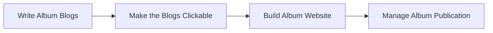

# 7. Albums

An **Album** is a live date-range query over the master. It holds no pictures —
just an `.ini`, blog texts and a cover — and its website is rendered from the
master's own files. See [Concepts](00-concepts.md#album-called-virttrip-in-the-code).

This menu mirrors the trip pipeline, minus everything to do with owning
pictures: there is no ingest, no freeze, no commit, because there is nothing to
ingest, freeze or commit. There is only writing it up and publishing it.

| Item | Needs |
|---|---|
| Find Trips in the Master… | A full master |
| Create Album | A full master |
| Write Album Blogs | An active album |
| Make the Blogs Clickable | An active album |
| Build Album Website | An active album |
| Manage Album Publication… | |
| Album Species Viewer | |
| Sync Placed GPS into the Index… | An active album |
| Export Album | An active album |
| Import Album | A master |
| Delete Album… | An active album |

> **Full master required.** Create Album and Find Trips need a real master, not a
> SmallMaster travelling install — an album is a query, and a partial collection
> would answer it wrongly.

---

## Getting an album

### Find Trips in the Master…

*Needs: a full master.*

**Report only.** Scans the master and reports date ranges that look like trips —
clusters of days with pictures.

It is the read-only companion to Create Album, and it exists because the date
range is precisely the thing you cannot remember about a journey from six years
ago. The master already knows. Use its output to fill in Create Album.

### Create Album

*Needs: a full master.*

Creates the album's directory structure and asks for its details and date range.

There are two scenarios, and the dialog handles both:

1. **From a retired trip** — normally you do not come here at all; [To Master ▸
   Retire Trip to Album](05-to-master.md) does this for you, blogs and all.
2. **Retroactive** — a journey that never had a trip repository. You pick the date
   range, and then build the blogs day by day from a template, reviewing each one.

The date picker fills the dates for you. (The old separate "Extract Days" step was
retired, not folded in — a retroactive album reads its days from the master
directly.)

---

## Writing it up and publishing it

The album's own three-step cycle, mirroring the trip pipeline:

### Write Album Blogs

*Needs: an active album.*

Generates the album's day blogs from the master's pictures in its date range.

There is an option to **clear old** blogs first. Use it when rebuilding an album
that already has pages — otherwise stale pages can survive the rebuild.

> **Blog state is visible.** A blog that was auto-created but not yet reviewed
> shows amber; one you have edited or reviewed shows green. Retired-trip blogs
> land green (they were written during the trip); retroactive ones start amber
> until you write them.

### Make the Blogs Clickable

*Needs: an active album.*

Adds species hyperlinks and next/previous navigation to the album's blogs, exactly
as the trip step of the same name does. A required finalize step, not a cosmetic
one.

### Build Album Website

*Needs: an active album.*

Renders and uploads the album's website at `/trips/<slug>` — species pages, day
pages, index — from the master's files.

### Manage Album Publication…

Lists this album on the site's trip index, or removes it from there.

This is the **same dialog** as [Trips ▸ Manage Trip Publication…](04-trips.md) —
one implementation, two doors. Everything said there about the live index and the
immutable web slug applies here.

> **Noticed while writing this manual:** unlike every other album item, this one
> and *Album Species Viewer* are not gated on there being an active album — they
> stay clickable with nothing selected. Probably an oversight rather than a
> design decision.

---

## Reviewing and editing

### Album Species Viewer

The album's editable species view: the master's pictures within the album's date
range, with ratings, colour labels and species assignments editable.

Because an album is a window on the master, **edits here mirror into the master
database**. This is the intended way to keep improving a journey's pictures after
the trip repository is long gone.

Its scopes and filters are in
[10. The viewers](10-viewers.md#the-species-viewers) — note especially that in an
album a colour-delete removes **master** pictures, not working copies.

### Sync Placed GPS into the Index…

*Needs: an active album.*

For this album, copies the **place name and movable flag** that a hand-placed
coordinate already carries in its sidecar into the master index.

Symptom it fixes: cards showing raw coordinates instead of a place name, for
pictures whose position you set by hand on the map. The sidecar knew the name;
the index had not been told.

---

## Moving and removing

### Export Album

*Needs: an active album.*

Zips the album's recipe, blog drafts and day data. Small — there are no pictures
in an album to zip.

### Import Album

*Needs: a master.*

Unpacks an album export on this machine. It needs a master, because the album
without a master is a query with nothing to query.

### Delete Album…

*Needs: an active album.*

Deletes the active album. **The master is untouched** — that is the whole point of
an album: it is cheap to delete and can be rebuilt from the same date range.

It is zipped to `.trash` first, so a mistaken delete is recoverable. The delete
renames before removing, and retries on Dropbox locks.
