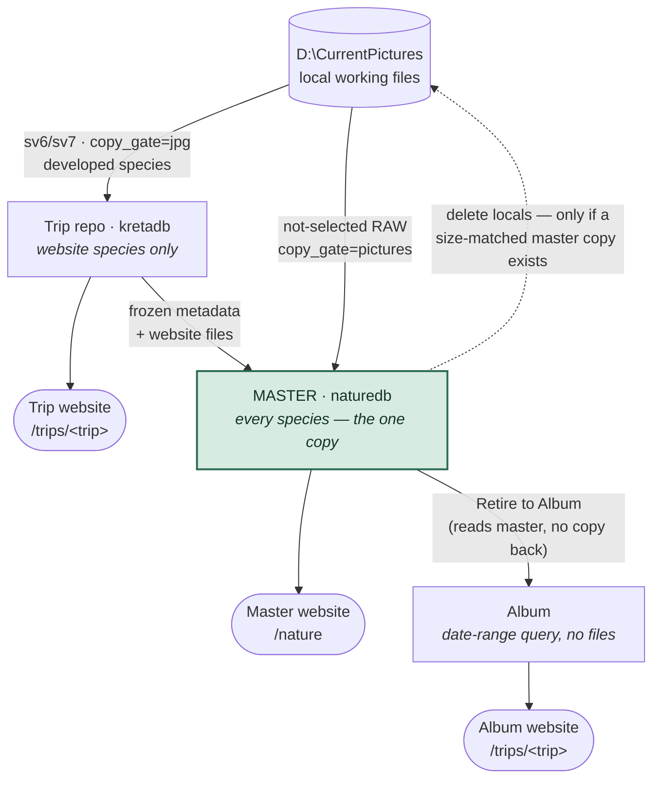
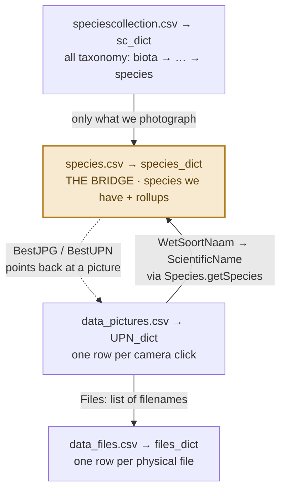
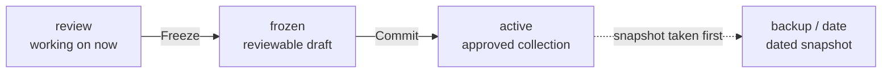

# Appendix C — Dataflow and architecture

*How data moves: from the camera to the master.*
Verified against the code on 2026-07-27 (incorporates the review rounds of that
week). For the deeper four-CSV data model, see [Appendix E](appendix-e-data_structures.md).

---

## Four places pictures can live

Everything in SpeciesViewer is a movement between four repositories. Getting
these four straight is most of understanding the system — most of the historical
bugs were confusion about *which* repository a step was writing into.

| Repository | Where | Holds | Role |
|---|---|---|---|
| **Local working pictures** | `D:\CurrentPictures\<year>\<trip>\<day>` | The live RAW / XMP / JPG / DOP files you cull and edit. The originals. | Working set. Cleared under control once the files are safely in the master (step 6). |
| **Trip repo** | `…\trips\<trip>db` (e.g. `kretadb`) | The **website species files only** — developed pictures + per-day review metadata & blogs. | **Transient.** Powers the trip website; retired once an album exists. |
| **Master** | `…\naturedb` | **Every species** across all trips — good and not-so-good — plus the canonical CSVs. | The long-lived, **single copy** of your collection (Dropbox aside). After a merge, this is the copy that remains. |
| **Album** (virttrip) | `…\virttrips\<trip>` | **No pictures.** Just an `ini`, blogs and a cover — a live date-range *query* over the master. | Reporting after the merge. Its pages are built from the master's own files; nothing is copied back in. |

Plus **per-machine caches** (`%LOCALAPPDATA%\SpeciesViewer\`: EXIF cache, preview
cache, the master SQLite DB) — never a source of truth, always rebuildable, and
deliberately *not* in Dropbox.

---

## Where the files go

Two things trip people up: the **master is fed from two sources** (developed
files via the trip repo, undeveloped RAWs straight from local), and **deletion
is the last arrow** — it only fires against files the master already physically
holds.

> **⚠ The load-bearing invariant.** Once the local originals are deleted, **the
> master is the only copy.** So every row it lists must have its file physically
> present behind it. In mid-2026 **two faults lined up**: the freeze wrote master
> CSV rows for files it had *not* actually copied (*ghost rows*), and the delete
> step decided what to remove by reading that CSV list *rather than looking at the
> disk*. So it deleted ~14,000 local originals whose "master copy" existed only on
> paper.
>
> Guardrails now in code: the merge copies *all* species (`copy_gate="pictures"`
> in master mode); a copy-verification step aborts the freeze if any file didn't
> land; and the delete now **walks the actual files on disk, not the CSV** —
> refusing to remove a local unless a size-matched master copy is physically
> present (`trip_delete_scan.py`). The moral: the delete trusted a list that
> lied; now it trusts the disk.

---

## The life of a trip, step by step

Each of these is a real, distinct operation in the GUI — a genuine sequence.

1. **Ingest.** SD card → `D:\CurrentPictures`. Cull, add GPS place-names, write
   sidecars. (The 'blue / purple delete' that drops weak shots happens here.)
2. **Develop.** PhotoLab / Lightroom produce JPG renders, `.dop` and `.xmp`
   alongside the RAWs.
3. **Trip pipeline (per day).** Read & Summarize → Write Blog →
   **Publish Day** (Freeze + Commit; Freeze builds the website, so the old
   separate Build Website step is gone). Copies the *developed* species files into
   the trip repo (`copy_gate="jpg"`). Undeveloped species are *not* copied here.
4. **Publish Trip to Master.** Three parts: publish species names → list the trip
   on the site → **Merge Pictures into Master**. The merge runs the same pipeline
   in `master_mode`, pulling developed files from the trip's frozen metadata *and*
   undeveloped RAWs from local. The master now holds every identified species file.
5. **Retire Trip to Album.** The trip becomes an album: a live date-range query
   over the master. The `/trips/<trip>` website is now generated from the master's
   own files — nothing is copied back into the master.
6. **Delete locals.** Now the species-named files in `CurrentPictures` can be
   cleared — under control, and only each file the master physically holds
   (size-matched). This is the deliberate post-merge cleanup, distinct from the
   culling delete in step 1. Non-species files stay local.
7. **Remove the trip repo.** Once the album is set up, the trip repo is dead
   weight. Remove it (right-click the trip, or the Delete Trip action).
   `CurrentPictures` and the master are untouched.

Steps 5 and 6 are independent — either order is safe once the merge is done.
Setting the album up first is just the less alarming way round: the reporting is
in place *before* anything local is deleted.

> **Shortcut route.** *Add Pictures to Master* ingests a folder (or a dragged
> pool) straight from local into the master, bypassing the trip repo entirely.
> Same copy rules apply — it's how ad-hoc "working days" reach the collection
> without a full trip.

---

## `getRepositoryPath()` means different things in different modes

It returns *the repo the current run writes into*, which depends on mode:

- **Trip mode** (normal config) → the trip repo, e.g. `kretadb`.
- **master_mode** (`MasterBiotaDatabase=""` makes `isMasterRepository()` true) →
  the master.

Trip **Publish** and the **Merge** run the *same* sv6/sv7 code — only the target
repo differs. That is why a fix to the copy logic must be correct in **both**
modes, and why the copy gate is chosen by mode:
`biota_gate = "pictures" if isMasterRepository() else "jpg"`.

---

## The data model, in brief

The same four structures are used in every repository. Two describe **biology**
(what species exist), two describe **your photos** (what files you have). They
meet at exactly one join: a scientific-name string. (Full detail:
[Appendix E](appendix-e-data_structures.md).)

| CSV | In-memory | Holds |
|---|---|---|
| `speciescollection.csv` | `sc_dict` | Pure taxonomy. Seeded with a full bird list — species you've never photographed included — grown to other kingdoms via GBIF. |
| `species.csv` | `species_dict` | **The bridge**: the taxonomy subset you *have pictures of*, plus rollups (best JPG, counters, target path). |
| `data_pictures.csv` | `UniquePictureName_dict` | One row per **camera click** (UPN), grouping its files + distilled metadata. |
| `data_files.csv` | `files_dict` | One row per **physical file** — RAW, its sidecars, and the JPGs rendered from it (`_DxO.jpg`). |

**The key idea:** biology (`sc_dict`) knows nothing about cameras or files; your
photos (`files_dict`, `UniquePictureName_dict`) know nothing about taxonomy
beyond a single foreign key. `species.csv` sits between them. The two halves join
at picture-write time via `Species.getSpecies`, which resolves whatever the user
typed in `XMP:Subject` — Dutch, English, scientific, misspelled, with a
"male / juv. / winter" qualifier — to a canonical scientific name; a new name
calls GBIF and grows the taxonomy.

**What a UPN is:** the lowercased filename stem with software suffixes stripped
(`-DxO`, `_DxO`, `-orf`, `-nef`, ` - copy`…). So `_O9173432.ORF`, `.XMP`,
`-DxO.dng` and `-DxO.jpg` collapse to one picture record. Uniqueness isn't
enforced by metadata — you supply a prefix like `2026 Kreta-` so files sort and
group without relying on EXIF that may not be present.

---

## Why editing feels instant — and is still safe

Changing a rating or a colour while culling is instant — too fast, it feels, to
have reached the disk. What actually happens matters for your data.

- **Reading is cache-first.** Opening a folder does *not* run exiftool on every
  file. It reads a small per-folder cache (a JSON file in `%LOCALAPPDATA%`,
  checked against each file's modified-time). A cache hit costs one `stat()`.
  Only new or changed sidecars are actually read; previews come from a separate
  image cache.
- **Editing is written through, immediately.** A rating / colour / description
  change is written to the sidecar on disk the moment you make it — to the `.dop`
  (PhotoLab's channel) and/or the `.xmp`, via one long-running exiftool process.
  The in-memory value and the on-disk cache are updated in the same step. It's
  fast because the write is cheap, not because it's deferred.

> **Sidecar vs. cache — the distinction that has bitten us.** The **sidecar on
> disk is the truth**, written immediately — an edit is never *lost*. The
> **cache is only a fast mirror**. The "out of sync" trouble was the mirror
> *drifting*, not a lost edit: a partial write once re-stamped the cache's
> timestamp as if the whole row were current (hiding a just-written GPS
> coordinate), and a cache kept in Dropbox could fail to save silently. Both are
> fixed — a partial write now *invalidates* the entry, and the cache lives on the
> local SSD. Worst case today is a stale *display* until the next read.

> **On close, nothing needs to happen.** There is no buffer of unsaved edits —
> every change is already on disk by the time you move to the next picture.

---

## review → frozen → active

Editing is instant, but a picture only becomes part of the *approved* collection
when you commit it. Every "Publish" or "Commit" moves a batch through three trays:

- **review** — the batch you're working on right now: one day, one import, one
  dragged pool. Nothing here is final.
- **frozen** — a snapshot you can eyeball and hand-edit before committing. It's
  only a reviewable copy; nothing is deleted here.
- **active** — the approved, committed collection. What the website and the
  master are built from.

On read, the committed *active* version always wins over an in-flight *review*
draft — approved data can't be clobbered by a batch still being worked on. On
commit, each species' per-run counters fold into its collection totals and reset.

> **In a trip, this is all local — and disposable.** Freeze and Commit inside a
> trip only write the trip repo's own CSVs. Because every metadata edit was
> already written back to the *source* pictures, the trip repo (and the website
> it produced) can be deleted and rebuilt from source at any time. Re-publishing
> **overwrites** the FTP site in place on the next run; it isn't torn down first.

---

## Code map

| Concern | File |
|---|---|
| Column lists for all four CSVs (source of truth) | `engine/csv_columns.py` |
| Project orchestration, files & pictures dicts | `engine/projectlib.py` |
| Taxonomy, GBIF lookup, master/trip name merge | `engine/speciesclassification.py` |
| Counters, best-JPG rollup | `engine/specieslib.py` |
| CSV read/write, UPN derivation | `engine/handling.py` |
| Culling reads/writes (sidecar cache, write-through) | `gui/sidecar_provider.py` |
| Freeze / copy gate | `batch/sv6Freeze.py` |
| Commit | `batch/sv7WriteCommit.py` |
| Ground-truth delete (walks disk, size-matches master) | `engine/trip_delete_scan.py` |

---

## On complexity — a note for later

In the author's own words: *"when I made the process it seemed logical, but it is
terribly complex."* Two sources feeding the master, a transient website-only trip
repo, and `getRepositoryPath()` meaning different things in different modes —
that's a lot of parts for "get the pictures into the master and clean up." This
document is step one: making it *legible*. A later pass could look at
**simplifying** the flow — a single merge source, or folding Publish + Merge.
