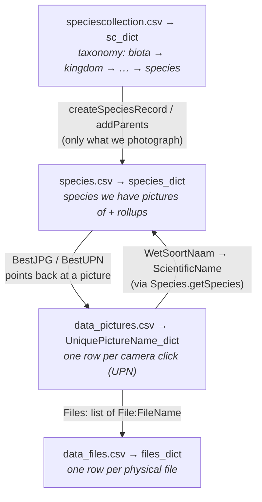

# Appendix E — Developer reference: Data structures

This is a developer reference for the four CSV files that hold all the project's
biological knowledge and picture metadata, and the four in-memory dictionaries
they map to. The same four structures are used in both the **master**
repository (the long-lived, "approved" picture collection) and in **trip**
repositories (a stretch of consecutive days, processed and then merged back
into master).

The focus is on relationships between the structures and the few
load-bearing fields. The exhaustive column lists live in
[speciesviewer/engine/csv_columns.py](../../speciesviewer/engine/csv_columns.py) — that file is the single
source of truth, this document deliberately does not mirror it.

## The four structures at a glance

| CSV (on disk) | In-memory dict | Owning class | Holds |
|---|---|---|---|
| `speciescollection.csv` | `sc_dict` | [`SpeciesClassification`](../../speciesviewer/engine/speciesclassification.py) | Pure taxonomy with parent/child links and vernacular names. **Seeded with a full bird list** — species you've never photographed included — and grown to plants, mammals, insects, etc. on the fly via GBIF. |
| `species.csv` | `species_dict` | [`Species`](../../speciesviewer/engine/specieslib.py) | **The bridge** between taxonomy and photos: the subset of the taxonomy we actually have pictures for, **plus** per-species rollups (best JPG, counters, target path). |
| `data_files.csv` | `files_dict` | [`Project`](../../speciesviewer/engine/projectlib.py) | One row per **physical file** — RAW, XMP, DOP, **the JPGs rendered from the RAW** (e.g. `_DxO.jpg`), DNG… — with raw EXIF/XMP read by exiftool. |
| `data_pictures.csv` | `UniquePictureName_dict` | [`Project`](../../speciesviewer/engine/projectlib.py) | One row per **camera click**, grouping the files that belong to that click and holding the distilled picture-level metadata. |



## Key idea: where biology lives vs. where camera data lives

- **Biology / topology** is in `sc_dict` (and the subset `species_dict`).
  These dicts know nothing about cameras or files. They are the answer to
  "what species exist, what family does this bird belong to, what's its
  Dutch name?". The taxonomy is bootstrapped from a static
  `initial_speciescollection.csv` (a full bird taxonomy, most of it never
  photographed) and extended on the fly via GBIF for the other kingdoms
  ([`SpeciesClassification.addSpecies`](../../speciesviewer/engine/speciesclassification.py)).
- **Photographic evidence** is in `files_dict` and `UniquePictureName_dict`.
  These dicts know nothing about taxonomy beyond a single foreign key
  (`WetSoortNaam` — the scientific name string). They answer "what files
  do I have, what camera, lens, GPS, rating?".

The two halves are joined by name lookup at picture-write time
([`Species.getSpecies`](../../speciesviewer/engine/specieslib.py)), which resolves whatever
the user typed in the XMP `Subject` field — Dutch, English, scientific,
misspelled, with a "male/winter/juv." qualifier — to a canonical lowercase
scientific name that exists in `sc_dict`. If the name is new, GBIF is
called and the result is added to `sc_dict` (and consequently to
`species.csv` once written).

## Each structure in more detail

### `sc_dict` — the taxonomy graph

- Keyed by lowercased scientific name (`"aves"`, `"haliaeetus leucocephalus"`).
- Each entry has `Level` (a `Level` enum: `BIOTA / KINGDOM / PHYLUM / CLASS / ORDER / FAMILY / SPECIES`),
  `ScientificName`, `DutchName`, `EnglishName`, `Up` (parent's scientific name),
  and `Leaves` (list of children's scientific names).
- Two parallel indexes are built at load time:
  `dutch_dict` and `english_dict`, each mapping vernacular name → scientific name.
  These are how a user-supplied `XMP:Subject` like `"witkopzeearend"` finds
  its way to `"haliaeetus leucocephalus"`.
- `Up` and `Leaves` together form a tree rooted at `"biota"`. Walking `Up`
  from any species gives the full lineage; walking `Leaves` recursively
  enumerates everything below a node — used for the per-family/per-order
  pages on the website.
- A trip's `sc_dict` is folded into the master's via
  [`mergeSpeciesCollections`](../../speciesviewer/engine/speciesclassification.py): species
  not in master are added; vernacular names already in master are never
  overwritten by the trip (master is canonical for names).

### `species_dict` — taxonomy ∩ "we have pictures"

- Same key (scientific name), and the same first six fields as `sc_dict`
  (`Level`, `ScientificName`, `DutchName`, `EnglishName`, `Up`, `Leaves`).
  This redundancy is intentional — `species.csv` is self-contained and
  can be read without `speciescollection.csv` present.
- Additionally holds per-species **photo rollups**:
  - `BestJPG`, `BestUPN`, `BestJPGPathName`, `currentHighestRating` — chosen
    by [`summarizeSpeciesCounters`](../../speciesviewer/engine/specieslib.py), bubble up the
    tree so a family node's "best JPG" is the best one beneath it.
  - `TargetPath` — where on disk the species' pictures get written
    (derived from the lineage, e.g. `animalia/chordata/aves/...`).
  - `JPGmap` — list of JPGs known for this species.
  - Counters split into **`...ThisRunCount`** and **`...CollectionCount`**:
    `ThisRun` is what the current trip/project just produced, `Collection`
    is the master total. On commit, `ThisRun` is added into `Collection`
    and reset to zero ([`writeSpeciesInfo` with `commit_counters=True`](../../speciesviewer/engine/specieslib.py)).
- Entries are created lazily: when `getSpecies` resolves a name and the
  scientific name isn't in `species_dict` yet, a record is built from
  `sc_dict` and all its parents are also injected via `addParents`. So
  `species_dict` is always a connected subtree of `sc_dict`.

### `files_dict` — raw EXIF, one row per file

- Keyed by `File:FileName` (just the filename, not the full path —
  uniqueness is assumed within a repository).
- Every column is a raw `exiftool` field: `EXIF:DateTimeOriginal`,
  `Composite:GPSPosition`, `XMP:Rating`, `XMP:Subject`, `EXIF:LensModel`,
  `MakerNotes:FocusDistance`, etc. See [`csv_columns.py`](../../speciesviewer/engine/csv_columns.py)
  for the full list.
- Populated by [`sv2ReadDirExif.py`](../../speciesviewer/batch/sv2ReadDirExif.py), which
  walks the project's source directory and runs exiftool.
- This dict is content-addressable EXIF storage. Nothing taxonomic lives
  here — even `XMP:Subject` is just the user-typed string at this stage.
- `UniquePictureName` is also stored on the file row, derived by
  [`deriveUniquePictureName`](../../speciesviewer/engine/handling.py). This is the FK back
  into `UniquePictureName_dict`.

### `UniquePictureName_dict` — one row per camera click

- Keyed by **UPN** (unique picture name) — the lowercased filename stem
  with software suffixes stripped (`-orf`, `-DxO`, `_DxO`, `-jpg`, `-nef`,
  ` - copy`, etc.). So `_O9173432.ORF`, `_O9173432.XMP`,
  `_O9173432-DxO.dng`, and `_O9173432-DxO.jpg` all collapse to the same
  UPN and become one picture record.
- The `Files` column is a Python list of `File:FileName`s — the FK list
  into `files_dict`. On read it's parsed back from its CSV string form
  (see the list-parsing block in [`read_pictures`](../../speciesviewer/engine/handling.py)).
- All other fields are **distilled** from those files by
  [`Project.UpdatePicture`](../../speciesviewer/engine/projectlib.py). The distillation
  rules are encoded in helpers like `findXMPItem` (prefer XMP, fall back
  to JPG), `findJPGItem`, `findRawOrJPGItem`, `findCameraOrXMPItem` —
  picking the right source per field (e.g. rating from XMP, image size
  from camera/XMP, GPS from anywhere).
- The taxonomy link is `WetSoortNaam` (scientific name), filled from
  `XMP:Subject` via `Species.getSpecies`. `EngSoortNaam` and `NLSoortNaam`
  are populated from the matching `sc_dict` entry. `Kingdom` … `Family`
  are denormalised onto the picture row so the website can render them
  without traversing back through `sc_dict` at render time.
- Additional decoded qualifiers (`malefemale`, `ageintext`, `summerwinter`)
  come from [`Species.getBirdInfo`](../../speciesviewer/engine/specieslib.py) parsing the
  subject string for tokens like "male", "juv.", "winter".

## Master vs. trip — same shape, different role

A repository is the unit that owns all four CSVs. The directory layout is
created by `Repository.populate`:

```
<repo-root>/
  biota/                       # the actual picture files (very big)
  metadata/
    initialize/                # blank/seed CSVs (immutable templates)
    active/                    # the canonical, committed CSVs
      species.csv
      speciescollection.csv
      data_files.csv
      data_pictures.csv
      backup/                  # dated snapshots taken at every commit
    review/<project-name>/     # in-flight: a single trip / day / batch
      data_files.csv           # this batch only
      data_pictures.csv
      frozen/                  # consolidated active+review, ready to commit
        frozen_data_files.csv
        frozen_data_pictures.csv
        species.csv
    web/                       # generated HTML
```

A **trip repository** has the exact same layout. What makes it a trip is
that its `config.ini` sets `[master] MasterBiotaDatabase = <path-to-master>`
(see [`Project.initMasterAndTrip`](../../speciesviewer/engine/projectlib.py)). The trip
processes its own days in `metadata/review/<day>/`, freezes them, commits
them into its own `metadata/active/`, and the trip's accumulated species
get merged back into master via
[`svr5MergeSpeciesCollections.py`](../../speciesviewer/batch/svr5MergeSpeciesCollections.py).

In master, the same flow runs but there's no upstream to merge to.

## Lifecycle: review → frozen → active

The state machine is what makes the "approved" property meaningful. A
single batch (a day, a project) walks through these stages:

1. **Scan** — `sv2ReadDirExif.py` writes
   `metadata/review/<project>/data_files.csv` from exiftool output.
2. **Group into pictures** — `sv3WritePictures.py` reads `data_files.csv`,
   collapses files into UPNs, calls `Species.getSpecies` (which may hit
   GBIF and grow `sc_dict`), and writes `data_pictures.csv` plus an
   updated `species.csv` for the project.
3. **Build & blog** — `sv4WriteBlog.py` / `sv5BuildWebsite.py` read both
   the active (already-committed) CSVs *and* the review CSVs to render
   pages that include the new pictures.
4. **Freeze** — [`sv6Freeze.py`](../../speciesviewer/batch/sv6Freeze.py) concatenates
   `active/data_files.csv` + `review/<project>/data_files.csv` →
   `review/<project>/frozen/frozen_data_files.csv` (and likewise for
   pictures and species). This is the human-review artifact: the user
   can edit it, build a `deletelist.csv` for pictures to drop, etc.
5. **Commit** — [`sv7WriteCommit.py`](../../speciesviewer/batch/sv7WriteCommit.py) snapshots
   the current `active/*.csv` into `active/backup/<date>_*.csv`, then
   copies the `frozen_*.csv` files over the active ones. At this point
   the run-counters in `species.csv` are folded into the collection
   counters and reset (see `commit_counters=True` in
   [`writeSpeciesInfo`](../../speciesviewer/engine/specieslib.py)). The pictures are now
   "approved" and part of the canonical collection.

When [`Project.readProject`](../../speciesviewer/engine/projectlib.py) loads a repository,
it deliberately layers reads in this order:

1. The committed `active/` CSVs (the baseline).
2. Any earlier in-flight projects under `metadata/review/*` that have
   *not* yet been committed (so their species and pictures are visible).
3. The current project's own `review/<project>/` CSVs.

The duplicate-detection in [`read_file`](../../speciesviewer/engine/handling.py) and
[`read_pictures`](../../speciesviewer/engine/handling.py) means later reads never override
earlier ones — the committed active version always wins, and review-stage
data only fills in things active doesn't know about yet. This is what
keeps "approved" approved.

## Where to look in the code

| Concern | File |
|---|---|
| Column lists for all four CSVs | [`speciesviewer/engine/csv_columns.py`](../../speciesviewer/engine/csv_columns.py) |
| Project-level orchestration, `files_dict` / `UniquePictureName_dict` | [`speciesviewer/engine/projectlib.py`](../../speciesviewer/engine/projectlib.py) |
| `sc_dict`, GBIF lookup, master/trip merge | [`speciesviewer/engine/speciesclassification.py`](../../speciesviewer/engine/speciesclassification.py) |
| `species_dict`, counters, best-JPG rollup | [`speciesviewer/engine/specieslib.py`](../../speciesviewer/engine/specieslib.py) |
| CSV read/write for files & pictures, UPN derivation | [`speciesviewer/engine/handling.py`](../../speciesviewer/engine/handling.py) |
| Picture record creation & EXIF distillation | `Project.CreatePicture` / `Project.UpdatePicture` in [`speciesviewer/engine/projectlib.py`](../../speciesviewer/engine/projectlib.py) |
| Freeze step | [`speciesviewer/batch/sv6Freeze.py`](../../speciesviewer/batch/sv6Freeze.py) |
| Commit step | [`speciesviewer/batch/sv7WriteCommit.py`](../../speciesviewer/batch/sv7WriteCommit.py) |
| Trip → master species merge | [`speciesviewer/batch/svr5MergeSpeciesCollections.py`](../../speciesviewer/batch/svr5MergeSpeciesCollections.py) |
