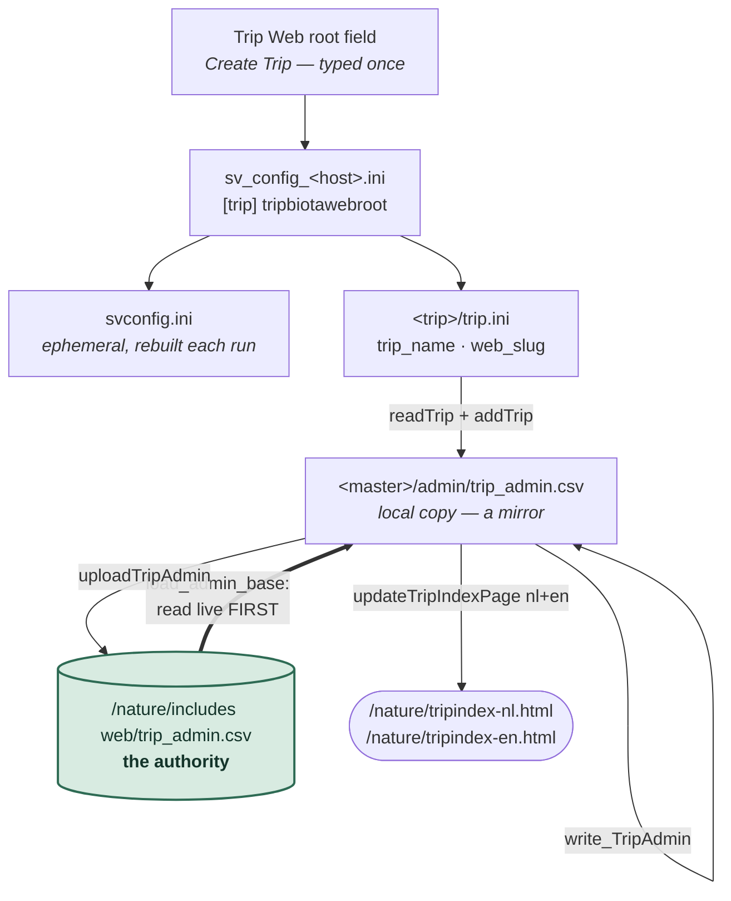

# How to: How a trip gets listed on the website

A trip's own website (`/trips/<slug>/` — blogs, species pages, pictures) and the
**listing that links to it** from `/nature/tripindex-nl.html` are two different
things, written by different steps, living in different files. Publishing the
site does not list it; listing it does not publish the site.

This document is about the listing half: the one CSV that drives it, the seven
places its key is written down, and the one mistake that cannot be undone by
any button in the app.

Companion reference: [configuration_inventory.md](../configuration_inventory.md)
for every other persistent file.

---

## One string, seven homes

Everything below is the same identity — the trip's **web slug** — copied along
a chain. You type it once, in **Trips ▸ Create Trip**, as a full web root
(`/trips/brazil2026`); everything downstream keeps either that path or its last
segment.

| Where it lives | Form | Written by |
|---|---|---|
| **Trip Web root** field, Select or Update Trip | `/trips/brazil2026` | you — **once, at create** (read-only afterwards) |
| `sv_config_<host>.ini` `[trip] tripbiotawebroot` | `/trips/brazil2026` | that dialog, and File ▸ Settings ▸ Repository Settings |
| `svconfig.ini` `[repository] BiotaWebRoot` | `/trips/brazil2026` | `generate_svconfig_ini()`, **regenerated before every batch run** |
| `<trip>/trip.ini` `trip_name` **and** `web_slug` | `brazil2026` | `generate_trip_ini()` — `Path(webroot).name` |
| `<master>/admin/trip_admin.csv`, column **6** | `brazil2026` | the four index writers below |
| `https://…/nature/includes web/trip_admin.csv` | `brazil2026` | uploaded by those same writers — **this copy is authoritative** |
| `/nature/tripindex-nl.html` + `-en.html` | `<a href="/trips/brazil2026">` | `updateTripIndexPage()`, rendered from the CSV |

Note that `trip_id` (the folder on disk, `brazil2026db`) is deliberately *not*
in this chain. Folder name and web address are allowed to differ, and here they
do.

---

## The live index is always the base

Four pieces of code write the trip index, and **all four start by fetching the
live CSV from the website**, never by trusting the local master copy:

| Action | Module |
|---|---|
| List a **trip** on the site | `batch/svr4UpdateTrips.py` |
| List an **album** on the site | `batch/svv5AddToMaster.py` |
| Remove either from the site | `engine/publish_index.py` `unadvertise()` (wrappers: `svrUnadvertiseTrip`, `svv8UnadvertiseAlbum`) |
| Remove a listing whose repo is gone | `gui/site_publication_dialog.py` |

The shared entry point is `engine.publish_index.load_admin_base()`.

The reason is that **trips are machine-specific**: a laptop can hold an early
copy of a trip that the desktop has since carried further, and its local master
lags behind. Since the whole index is regenerated from whatever base was
loaded, a stale local base would silently drop entries another machine
published — or resurrect ones that were removed.

Two consequences worth knowing:

- **Your local `admin/trip_admin.csv` is a mirror, not a source.** Every list or
  unlist run rewrites it from the live copy. A row that exists only locally
  (a trip published but never listed) disappears from it at the next run. That
  is intended; the row is regenerated from `trip.ini` whenever you list it.
- **Offline is an empty base, not an error.** `read_TripAdmin_from_web` swallows
  its own exceptions, so "no internet" and "the site lists nothing" arrive
  identically. `load_admin_base` falls back to the local copy when the web base
  comes back empty — never let a failed read become an empty write.

---

## ⚠ The slug is immutable once the trip exists

`addTrip()` is a dictionary assignment keyed on `trip_name`. Listing a trip
whose slug has changed therefore **adds a second row** rather than renaming the
first — and `unadvertise()` reads the key it should delete from `trip.ini`,
which by then already says the *new* slug, so it reports *"not listed, nothing
to remove"* and leaves the old row exactly where it was.

> **This happened.** A trip was created as `/trips/brazil2026db` (the folder
> name, `db` suffix and all). The mistake was noticed and the Trip Web root
> retyped to `/trips/brazil2026` in Select or Update Trip, which the dialog
> allowed. `trip.ini` moved to the new slug; the published folder and the live
> index row stayed on the old one. The public Trips page now linked to a folder
> that would no longer be written to, the next publish would have listed Brazil
> twice with one dead link, and no button in the application could reach the
> stale row — because every tool that removes a row looks it up by the slug the
> trip currently claims.

Which is why **Trip Web root is read-only in update mode** (grey, with the
reason in its tooltip). Create mode is where the slug is chosen. Renaming later
is a deliberate visit to **File ▸ Settings ▸ Repository Settings**, followed by the repair
below — and it is worth avoiding: a slug that is already on the public web has
been indexed by search engines and may sit in somebody's bookmarks.

---

## Repairing the index by hand

When the live index carries a row nothing in the app can address any more, fix
the CSV **on the server** and then use the normal door. The corrected live copy
becomes the base for the next run, so everything downstream falls into place.

1. **Download** `/nature/includes web/trip_admin.csv` (SFTP; on the server that
   is `…/www/nature/includes web/trip_admin.csv`).
2. **Edit the one field.** `trip_name` is **column 6**, not column 1 — the order
   is `master_repository_web; master_repository_disk; trip_banner; trip_picture;
   created; trip_name; fromdate; todate; oneblog; title_nl; message_nl;
   title_en; message_en`. Prefer a byte-level replace of `;oldslug;` → `;newslug;`
   over re-saving the file: the CSV is UTF-8 with CRLF line endings and message
   fields contain semicolons inside quotes, so a round-trip through a
   spreadsheet can change far more than you asked for.
3. **Upload it back**, overwriting.
4. **List the trip** — Trips ▸ *5. Manage Trip Publication…* ▸ **List Trip on the
   Site**. It fetches your corrected base, refreshes that row instead of
   duplicating it (same key now), regenerates both tripindex pages, and uploads
   all three files. Your local `admin/trip_admin.csv` is rewritten from the same
   base, so it self-corrects too.
5. **Check the public Trips page** — the link should point at the new slug.

Renaming the published folder itself (`/trips/oldslug` → `/trips/newslug`) is a
plain SFTP rename, and only matters if the trip already has pages worth keeping.

> **⚠ `read_from_local` does not work from the GUI.** The docstring of
> `load_admin_base` offers `[virttrip_addtomaster] read_from_local = true` as
> the recovery hatch: hand-edit the *local* CSV and publish from that. It is
> unreachable from the application, because `gui/batch.py` calls
> `generate_svconfig_ini()` immediately before every batch run and
> `utils/batch_config.py` never writes that section — so a hand-edited
> `svconfig.ini` is overwritten before the module reads it. The flag only works
> when a batch script is run from a command line with its own config file.
> Repair the server copy instead (above). If we ever want the hatch in the GUI,
> the mechanism already exists: `BatchModuleRunner` accepts `config_overrides`.

---

## Where to look when something is wrong

| Symptom | Look at |
|---|---|
| Trip listed twice, one link dead | Two rows in the live CSV — the slug changed. Repair above. |
| Trip missing from the Trips page | No row in the **live** CSV. List it; the local copy proves nothing. |
| "Not listed, nothing to remove" on a row you can see | The row's slug ≠ the slug in `trip.ini`. Repair above. |
| Links on the index lose their `/trips/` segment | The Project was built with the *master* web root. The index builds each URL as `parent(BiotaWebRoot)/trip_name`, so it needs a **trip** web root. |
| Index page reverted after publishing from another machine | Expected — the whole index is regenerated from the live base each time. Publish from the machine that holds the trip. |
