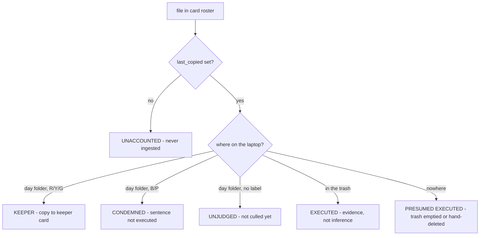

# Emptying an SD card safely

Feature branch `sv_empty_sdcard`. Agreed with Gilbert 2026-08-24, to be built
2026-08-25. Nothing here is written yet.

## Why

Ch. 18 settled that **the cards keep the pictures** for the whole trip: plenty
of them, no expectation of filling them, so RAW loss is not the risk. That
premise is not being re-opened — it is being *bought back*. It holds only while
there is a spare card in the bag, and a long trip eventually runs out.

This feature makes one card re-usable without guessing about a single frame:
consolidate the keepers of a finished card onto a cheap slow card, prove that
every other frame on it was *deliberately* discarded, and only then is the fast
card free to format.

It is emphatically **not** a mirror-everything backup. Nothing is copied that
has not already been judged.

## Two cards, and what each is for

| | role |
|---|---|
| **Source card** | the one you want to format. Mounted for its **roster and identity** — *not* as a copy source |
| **Keeper card** | big, slow, cheap. Write-once bulk |

The pictures come off **the laptop**, because that is where the prefixed names
and the `.xmp` files carrying the culling work live. The source card is the
witness, not the source.

Two readers are therefore required. Note the contrast with the work backup,
which was shaped by having only *one* reader ("inserting the SD-card ejects SV
INDEX"), and had to cache `survivors.json` on the laptop to cope. Here both
cards are present at once and no such cache is needed.

## The gate: every frame on the card must have a verdict

The card's `.sv_ingest_cache.json` is the roster — every file the card has ever
shown us, keyed by relative path. **Never use the laptop day folder as the
roster**: a frame that was shot and never copied is absent from it, and would
pass a check by not existing. That frame is the entire reason this gate exists.

Per-file `last_copied` is the discriminator. It is set at copy time
(`sv0ReadSDCard.py`, `cache.put(..., last_copied=now_str)`) and deliberately
*preserved* across later rewrites, so "was this frame ever ingested at all?" is
answerable from the card alone.



`UNACCOUNTED` or `UNJUDGED` above zero **blocks, unconditionally**. Everything
else is a verdict.

`EXECUTED` is real evidence rather than a guess: culling delete does not unlink,
it **moves** the stem to `trash_root/<stem>/` and takes the `.xmp` with it
(`sidecar_provider.delete_by_color`), so the blue/purple label is still readable
in the trash. Only `PRESUMED EXECUTED` is inferred, and it is the benign case —
the frame was ingested, judged, and is gone by someone's deliberate act.

## Condemned frames: the format is what makes it final

Blue/purple is a death sentence that is not always carried out immediately. At
consolidation time there is a pile of them still on the laptop, and **formatting
the source card is what makes their sentence irreversible** — silently, for
frames you had deliberately not finished with.

**Decision: copy them too**, into a separate `condemned\` folder on the keeper
card so they are out of the way of a normal re-read. The keeper card is the
cheap slow one; space is the resource we have most of. The gate says so in
words: *"15 condemned, not yet deleted — copied to the keeper card so the format
does not decide for you."*

Rejected: executing the deletions as part of consolidation (SV deleting on your
behalf), and silently leaving them behind (the format decides).

## The 99% rule

A card is only a candidate if it is **at least 99% full** — do not recycle a card
you have not finished with. `disk_space.report_volumes()` already returns
`total` / `free` / `pct_free`.

This one is an **override-able warning, not a refusal**. Mid-trip and out of
cards, "free me this 70% card" is exactly when the feature is needed, and a hard
gate turns SV into the obstacle at the worst possible moment — the same call
already made on the trip-retire blockers. The *unaccounted-frames* check is the
unconditional one; fullness is advice.

## What already exists, so what is actually new

The read half is **zero code**, and this was anticipated: `_SidecarIndex` exists
because "the source field accepts any folder, and a folder you have already
culled holds .xmp files carrying the species, stars and colours you set". So a
keeper card carries the culling work with the pictures, and `_write_sidecars`
only generates for a RAW *lacking* an `.xmp`, so a re-read cannot clobber what
the card carries. Content dedup makes the re-read idempotent. Point Read
SD-cards at a subfolder for one card, or at the root for all of them.

A pleasant side effect: because sidecars are **carried, not regenerated**, this
path does not hit the work backup's pre-2026-08-17 camera-UTC-offset caveat.

The copy half is nearly free too. `copy_card(include_names={day: {names}})`
already exists — a per-day allow-list, built for the work-backup restore, with
the deliberate asymmetry that a day *absent* from the map copies in full. It
already reports `summary["culled"]`.

Genuinely new: the roster reader, the classifier, colours → allow-list, the
clear stamp, and a dialog.

## Layout on the keeper card

```
SV KEEPERS (L:)
  SV_KEEPERS.json                       written LAST, from what actually landed
  2026 North Greece - card 03\
      2026-05-04\   *.ORF + *.xmp (+ *.dop)
      2026-05-05\   ...
      condemned\
          2026-05-04\  ...
  2026 North Greece - card 04\
      ...
```

One folder per source card, because that is the unit being freed and the unit
you point a restore at. The same day appearing under two cards is fine — content
dedup sorts it out on the way back in.

## The clear stamp

On success, stamp the **source card's own json**: cleared, trip, date, N keepers
on which keeper card, M deliberately discarded. Then the next time that card is
inserted — this trip or next year — SV says **"CLEAR — safe to format"** with no
help from the laptop. The answer is carried by the object in your hand, which is
the same principle as the 1 MB reserve.

It is self-cleaning: a card that has been shot on again has files with no
`last_copied`, so the stamp no longer covers the card and the verdict reverts to
unknown.

There is still **no unique card fingerprint** stored (listed as unbuilt back in
ch. 18 item 1b). Not needed to identify the card in the slot; it *is* what a
laptop-side list of cleared cards would need. Volume serial + label + first-seen
would do it. Out of scope for v1.

## ⭐ Rules that must not be undone

- **SV never formats and never deletes on the source card.** It writes the clear
  stamp; that is the whole of its authority there. The format is done by hand,
  by you, in the camera.
- **The stamp is written LAST, from what actually landed on the keeper card** —
  the work-backup lesson, where a manifest written up front produced a ZIP
  claiming files it did not have, and replaced the good one.
- **The card roster is the card's json, never the laptop day folder.**
- **A card with no `.sv_ingest_cache.json` is UNKNOWN, never clear.** Absence of
  evidence blocks. A card read by another tool, or read-only when we saw it, has
  no roster and cannot be cleared.
- **Unaccounted or unjudged > 0 blocks unconditionally.** Only the fullness rule
  is override-able.

## Build order

Each step stands alone and is testable on its own; step 1 is already useful
without any of the rest.

0. **`card_roster(card)`** — read `.sv_ingest_cache.json` → `{relpath: {sha,
   last_copied, capture_date}}`, plus the read history. No GUI, no copying.
1. **`classify(roster, project_root)`** → the six verdicts above, as counts and
   lists. A report: *"112 on card — 97 keepers, 13 executed, 2 condemned, 0
   unaccounted."* **This alone answers "can I format this card?"** and copies
   nothing. Stop here and use it for a day before building the rest.
2. **Fullness check** — one `disk_usage` call, override-able warning.
3. **The copy** — keepers → `include_names` → `copy_card` to the keeper card,
   condemned into `condemned\`. Verified copy and dedup come for free.
4. **The clear stamp**, written last from the copy's actual result.
5. **The dialog** — verdict table per day, the two gates, Consolidate button.

## Out of scope for v1

Formatting anything. Auto-detecting which volume is a keeper card. A laptop-side
registry of cleared cards (needs the fingerprint). Retiring the work backup's
`survivors.json` — see below.

## Open question, to settle before step 3

A keeper card **is** the survivor list, materialised: re-reading one copies only
keepers by construction, so `survivors.json` has nothing to do for a card that
has been consolidated. The work-backup ZIP still earns its place — it carries
species, blog text, lifer status and the CSVs, not merely which files survived —
but two mechanisms that both answer "which frames survived" will eventually
disagree. Decide deliberately whether a consolidated card retires the survivor
filter for its days, rather than letting them drift.
