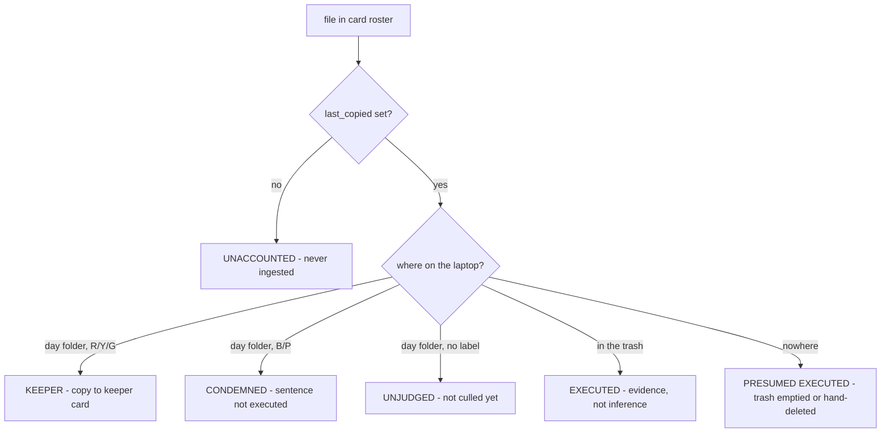

# Emptying an SD card safely

Feature branch `sv_empty_sdcard`. Agreed with Gilbert 2026-08-24.

**Status 2026-08-25: all six build steps written, engine tested, GUI untested
live.** `engine/card_empty.py` + `gui/card_empty_dialog.py` +
`tools/sv_card_report.py` (headless report) + `tools/sv_card_empty_selftest.py`
(seven checks, temp folders only). Menu: **Trips ▸ Empty a Card**.

## Why

Ch. 18 settled that **the cards keep the pictures** for the whole trip: plenty
of them, no expectation of filling them, so RAW loss is not the risk. That
premise is not being re-opened — it is being *bought back*. It holds only while
there is a spare card in the bag, and a long trip eventually runs out.

This feature makes one card re-usable without guessing about a single frame:
consolidate the keepers of a finished card onto a cheap slow card, prove that
every other frame on it was *deliberately* discarded, and only then is the fast
card free to format.

It is emphatically **not** a mirror-everything backup. Nothing is copied that
has not already been judged.

## Two cards, and what each is for

| | role |
|---|---|
| **Source card** | the one you want to format. Mounted for its **roster and identity** — *not* as a copy source |
| **Keeper card** | big, slow, cheap. Write-once bulk |

The pictures come off **the laptop**, because that is where the prefixed names
and the `.xmp` files carrying the culling work live. The source card is the
witness, not the source.

Two readers are therefore required. Note the contrast with the work backup,
which was shaped by having only *one* reader ("inserting the SD-card ejects SV
INDEX"), and had to cache `survivors.json` on the laptop to cope. Here both
cards are present at once and no such cache is needed.

## The gate: every frame on the card must have a verdict

The card's `.sv_ingest_cache.json` is the roster — every file the card has ever
shown us, keyed by relative path. **Never use the laptop day folder as the
roster**: a frame that was shot and never copied is absent from it, and would
pass a check by not existing. That frame is the entire reason this gate exists.

Per-file `last_copied` is the discriminator. It is set at copy time
(`sv0ReadSDCard.py`, `cache.put(..., last_copied=now_str)`) and deliberately
*preserved* across later rewrites, so "was this frame ever ingested at all?" is
answerable from the card alone.



`UNACCOUNTED` or `UNJUDGED` above zero **blocks, unconditionally**. Everything
else is a verdict.

`EXECUTED` is real evidence rather than a guess: culling delete does not unlink,
it **moves** the stem to `trash_root/<stem>/` and takes the `.xmp` with it
(`sidecar_provider.delete_by_color`), so the blue/purple label is still readable
in the trash. Only `PRESUMED EXECUTED` is inferred, and it is the benign case —
the frame was ingested, judged, and is gone by someone's deliberate act.

## Condemned frames: the format is what makes it final

Blue/purple is a death sentence that is not always carried out immediately. At
consolidation time there is a pile of them still on the laptop, and **formatting
the source card is what makes their sentence irreversible** — silently, for
frames you had deliberately not finished with.

**Decision: copy them too**, into a separate `condemned\` folder on the keeper
card so they are out of the way of a normal re-read. The keeper card is the
cheap slow one; space is the resource we have most of. The gate says so in
words: *"15 condemned, not yet deleted — copied to the keeper card so the format
does not decide for you."*

Rejected: executing the deletions as part of consolidation (SV deleting on your
behalf), and silently leaving them behind (the format decides).

## The 99% rule

A card is only a candidate if it is **at least 99% full** — do not recycle a card
you have not finished with. `disk_space.report_volumes()` already returns
`total` / `free` / `pct_free`.

This one is an **override-able warning, not a refusal**. Mid-trip and out of
cards, "free me this 70% card" is exactly when the feature is needed, and a hard
gate turns SV into the obstacle at the worst possible moment — the same call
already made on the trip-retire blockers. The *unaccounted-frames* check is the
unconditional one; fullness is advice.

## What already exists, so what is actually new

The read half is **zero code**, and this was anticipated: `_SidecarIndex` exists
because "the source field accepts any folder, and a folder you have already
culled holds .xmp files carrying the species, stars and colours you set". So a
keeper card carries the culling work with the pictures, and `_write_sidecars`
only generates for a RAW *lacking* an `.xmp`, so a re-read cannot clobber what
the card carries. Content dedup makes the re-read idempotent. Point Read
SD-cards at a subfolder for one card, or at the root for all of them.

A pleasant side effect: because sidecars are **carried, not regenerated**, this
path does not hit the work backup's pre-2026-08-17 camera-UTC-offset caveat.

The copy half is nearly free too. `copy_card(include_names={day: {names}})`
already exists — a per-day allow-list, built for the work-backup restore, with
the deliberate asymmetry that a day *absent* from the map copies in full. It
already reports `summary["culled"]`.

Genuinely new: the roster reader, the classifier, colours → allow-list, the
clear stamp, and a dialog.

## Layout on the keeper card

```
SV KEEPERS (L:)
  SV_KEEPERS.json                       written LAST, from what actually landed
  2026 North Greece - card 03\
      2026-05-04\   *.ORF + *.xmp (+ *.dop)
      2026-05-05\   ...
      condemned\
          2026-05-04\  ...
  2026 North Greece - card 04\
      ...
```

One folder per source card, because that is the unit being freed and the unit
you point a restore at. The same day appearing under two cards is fine — content
dedup sorts it out on the way back in.

## The clear stamp

On success, stamp the **source card's own json**: cleared, trip, date, N keepers
on which keeper card, M deliberately discarded. Then the next time that card is
inserted — this trip or next year — SV says **"CLEAR — safe to format"** with no
help from the laptop. The answer is carried by the object in your hand, which is
the same principle as the 1 MB reserve.

It is self-cleaning: a card that has been shot on again has files with no
`last_copied`, so the stamp no longer covers the card and the verdict reverts to
unknown.

There is still **no unique card fingerprint** stored (listed as unbuilt back in
ch. 18 item 1b). Not needed to identify the card in the slot; it *is* what a
laptop-side list of cleared cards would need. Volume serial + label + first-seen
would do it. Out of scope for v1.

## ⭐ Rules that must not be undone

- **SV never FORMATS the source card.** It *does* delete pictures from it —
  revised 2026-08-25, below — but only ones just verified on the keeper card,
  only on a separate explicit request, and never a file it does not recognise.
- **The stamp is written LAST, from what actually landed on the keeper card** —
  the work-backup lesson, where a manifest written up front produced a ZIP
  claiming files it did not have, and replaced the good one.
- **The card roster is the card's json, never the laptop day folder.**
- **A card with no `.sv_ingest_cache.json` is UNKNOWN, never clear.** Absence of
  evidence blocks. A card read by another tool, or read-only when we saw it, has
  no roster and cannot be cleared.
- **Unaccounted or unjudged > 0 blocks unconditionally.** Only the fullness rule
  is override-able.

## Build order

Each step stands alone and is testable on its own; step 1 is already useful
without any of the rest.

0. **`card_roster(card)`** — read `.sv_ingest_cache.json` → `{relpath: {sha,
   last_copied, capture_date}}`, plus the read history. No GUI, no copying.
1. **`classify(roster, project_root)`** → the six verdicts above, as counts and
   lists. A report: *"112 on card — 97 keepers, 13 executed, 2 condemned, 0
   unaccounted."* **This alone answers "can I format this card?"** and copies
   nothing. Stop here and use it for a day before building the rest.
2. **Fullness check** — one `disk_usage` call, override-able warning.
3. **The copy** — keepers → `include_names` → `copy_card` to the keeper card,
   condemned into `condemned\`. Verified copy and dedup come for free.
4. **The clear stamp**, written last from the copy's actual result.
5. **The dialog** — verdict table per day, the two gates, Consolidate button.

## Revised 2026-08-25 — after the first real run

His three observations, all acted on:

**"The keepers are complete, they are old."** The split that matters: RAW is
immutable, JPG and metadata are **fluent** — species names get corrected and
renders get made for days after a card is consolidated, while SV INDEX is
refreshed daily and the keeper card is not. Three consequences:

- The restore order in ch.18 already handles it. `restore_day` only overwrites a
  differing file with the caller's consent, and the keeper-card copy never
  overwrites an existing sidecar, so *ZIPs first, keeper card second* lands the
  fresh metadata and silently skips the stale. Reverse the order and you get
  asked instead. Do not "simplify" either half.
- `SV_KEEPERS.json` records **metadata_as_of**, so a card states its own
  staleness rather than implying currency.
- A re-run now **refreshes** `.xmp` / `.dop` / `.jpg` and never re-copies the
  RAW (`copy_known_files(refresh_exts=…)`). The "never overwrite a sidecar" rule
  exists because a destination may hold work done *there* — true of a picture
  folder, false of a keeper card. So "top up the keeper card" is a ~12 MB
  evening job, not a rewrite.

**No checkbox for what to copy.** Measured on the real card: sidecars 0.13%,
`.dop` 0.06%, renders 0.42% — **0.60% of the RAW payload, all in**. A setting
that can only move the total by half a percent is not a choice, it is a question
asked forever, and one you would have to be right about in advance about a card
you rely on months later. Same conclusion the work backup reached at 2500:1. The
one legitimate size question is *"will this fit?"*, which is a **constraint**:
`check_free_space` now runs as a pre-flight at the moment the byte total is
exact.

**Card identity.** There was none; the drive letter is whatever the reader
handed out and the volume label is often blank. `ensure_card_id` mints a UUID
into the card's own record, with the Windows volume serial alongside as
corroboration. It is written where we are already writing, never by
classification, which stays read-only.

**Deleting after a verified copy — added, with teeth.** He never formats, he
deletes by hand, so the tool stopping at "safe to format" was inviting the wrong
card to be wiped. `plan_delete` / `delete_from_card`:

- a separate click, never bundled with the copy;
- keepers and condemned frames must be **found on the keeper card at the right
  size** — anything else is reported as unverified and survives;
- executed/presumed frames have no copy by design, and are counted separately so
  the confirmation can say how many pictures are about to exist nowhere;
- **refuses if the card id does not match** the plan — cards get swapped between
  one step and the next, and this is the one irreversible operation;
- files not in the roster (`.dat`, `System Volume Information`) are never
  touched, and are counted so the survivors are visible.

**The card keeps its own record, pruned.** Deleting by hand takes the `.sv`
files too; doing it here keeps them and removes only the entries for the files
that went. The identity and read history are what make the *next* empty safe — a
card whose id is discarded every cycle is a stranger every time — and a card
left claiming to hold pictures it no longer has would break the clear stamp on
the next trip. Known gap, inherited from the reserve: a card handed to someone
else still carries this record.

**Folder naming.** The keeper folder uses the PICTURE folder's name
("2026 North Greece"), not the repo id ("greecedb"): it is written on a physical
card read months later and should match the prefix on every file inside it.

## Out of scope for v1

Formatting anything. Auto-detecting which volume is a keeper card. A laptop-side
registry of cleared cards (needs the fingerprint). Retiring the work backup's
`survivors.json` — see below.

## Settled 2026-08-25: survivors.json stays

His call — *"I do like the survivors.json"*. The keeper card does **not** retire
the survivor filter for its days; both mechanisms stay. They agree by
construction rather than by coordination: a keeper card holds only survivors, so
re-reading one gives the filter nothing to remove, and the filter still covers
every card that has *not* been consolidated. Nothing in this feature writes to
`survivors.json` or reads it.

## Found while building

Two defects the design did not anticipate, both fixed, both in
`tools/sv_card_empty_selftest.py` as checks 7 and 3:

- **The prefix bridge.** Card names are un-prefixed (`N5040114.ORF`), laptop
  names are prefixed. With no bridge nothing matched — and "matched nothing"
  presents as "every frame was deliberately deleted", which is the verdict that
  says *safe to format*. `derive_prefixes()` works the prefix out from the two
  name sets, and a card matching NOTHING now blocks outright. The first real
  card passed only by luck: it had been built by copying already-prefixed files
  back onto a card, so the two names were identical.
- **Case.** The roster is keyed lower-case, because a Windows filesystem is.
  Copying under that key renamed `P100.ORF` to `p100.orf` on the keeper card,
  breaking the name its `.xmp` and `.dop` are matched to.

And one pre-existing bug fixed on the way: `scan_source` skipped dot-FILES but
descended into dot-DIRECTORIES, so pointing a card read at an already-culled
folder copied everything in `.trash` back.

**`Grey`** turned out to be a sixth label value in the wild. It exists only as a
hardcoded swatch on the viewer's colour-filter bar (`image_viewer.py`), is not
in `label_colors.COLORS`, and carries no keep-or-discard meaning — so it blocks,
and the report names it instead of calling it "no colour set". Worth deciding
separately what Grey is *for*.
