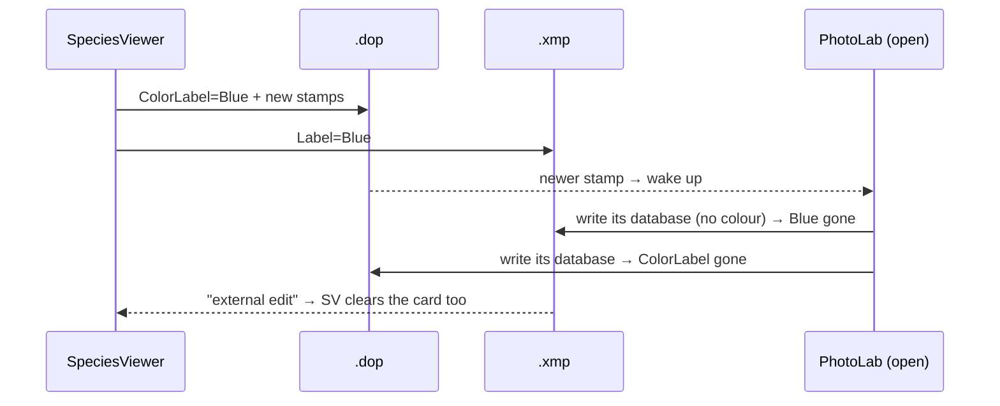

# SpeciesViewer vs PhotoLab: who writes which sidecar

*Test record and fix plan. Tests run live on 2026-09-29 on a throw-away Day,
after colours and ratings vanished on 2026-09-25. Step 1 shipped (`ca93186`); step 2 built and
passed T7, awaiting commit.*

---

## The problem

You apply a colour in SV, the card shows it, and a few seconds later it is gone:
from the screen **and** from the `.xmp`. On 2026-09-25 this undid an evening of
culling on 2026-09-06. Workaround until the fix lands: **cull with PhotoLab closed.**

## The test setup

- **Test day:** `D:/CurrentPictures/2026/2026 test1/2026-09-21`, registered as a
  Day (not a trip day, so nothing can reach the master). It holds 6 ORFs copied
  from 2026-09-06 (`N9062543` … `N9062548`) with their `.xmp`, **not** their
  `.dop`: a `.dop` carries a PhotoLab catalogue ID and a copy could turn into a
  virtual copy. PhotoLab authored fresh `.dop` files for 5 of the 6 (*Write
  sidecars*); `N9062548` started with no `.dop`.
- **Watcher:** a script logged every `.xmp`/`.dop` change in the folder to the
  millisecond, with colour, rating and the `.dop`'s internal `ModificationDate`.
  Put next to SV's log, it shows who wrote what, and in which order.
- **Switch:** `SV_DOP_WRITE` = `on` / `off` / `nostamp` (environment variable, set
  in `launch.json`), so the tests could run without changing the design.

**PhotoLab settings during all tests** (Preferences):

| Setting | Value |
|---|---|
| Save settings in sidecar file (.dop) automatically | on |
| Load settings from sidecar file (.dop) automatically | on |
| **Synchronize metadata with XMP sidecar files** | **on** |

With XMP sync on, PhotoLab's own text says: *"metadata from .dop sidecar files
will be ignored; metadata from .xmp sidecars will be used instead."*

## The results

| Test | PhotoLab | SV writes | Result |
|---|---|---|---|
| **T0** | open | `.xmp` + `.dop` with new stamps (the code as it was) | ❌ **Friday reproduced.** PL rewrites the `.xmp` 3 s later, byte-for-byte its old version, colour gone. ~40 s later it also strips `ColorLabel` from the `.dop`. |
| **T1** | open | `.xmp` only | ✅ Colours stay. PL does not react at all, and does not show them either. |
| **T1b** | open → *File ▸ Metadata ▸ Read from image* | — | ✅ PL adopts the colours and writes them into its own `.dop` files; it even **creates** the missing one for `N9062548`. The `.xmp` is left alone. |
| **T3** | closed → started | `.xmp` only, incl. a **changed** value (Blue → Green) and 3★ | ✅ PL reads all three at startup and writes its own `.dop`. |
| **T4** | open | `.xmp` only, then click another folder and back in PL | ✅ PL picks up the change on the click back and keeps it. **No restart needed.** |
| **T5** | closed → started | crop + colour, `.dop` with new stamps | ✅ PL shows the crop and the colour. It rewrites the `.xmp` itself, keeping the crop and the rating. |
| **T6** | open, not yet caught up | after step 1: Purple then crop on 546, Green on 544, exposure on 547 | ❌ on 546: the crop's `.dop` write woke PL, and 3 s later it wrote its **old** colour (Yellow) over our Purple. ✅ Green on 544 (colour only) survives. ✅ Exposure on 547 also wakes PL, but nothing is lost, since PL's database already agreed on that picture's colour and rating. |
| **T7a** | open on another folder | step 2: colour + crop + exposure held in the `.xmp`; *Open in PhotoLab* in the Editor | ✅ No `.dop` write while editing. The button points PL at the folder; PL reads our colours within ~1 s; 8 s later SV writes the held `.dop` edits; PL wakes, rewrites the `.xmp` 3 s later **keeping our colour**, and shows crop and exposure. |
| **T7b** | open on this folder | same, from a picture in the folder PL already shows | ✅ Pointing PL at a folder it already shows also makes it re-read (0.6 s). Red + crop arrive intact. A later handover finds nothing to do (0 `.dop` updated): no ping-pong. |

### T0 as the watcher saw it

```
11:13:23.88  SV  .dop  ColorLabel=Blue, new stamp
11:13:24.18  SV  .xmp  Label=Blue            (5711 bytes)
11:13:26.89  PL  .xmp  Label gone            (6061 bytes: its own old file)
11:14:03.88  PL  .dop  ColorLabel removed, on both pictures, one shared stamp
```



## What this means

1. **The `.dop` write is what wakes PhotoLab.** An `.xmp` write does not (T1).
2. **Once awake, PhotoLab writes out its own database.** It does not merge. If
   its database is behind the `.xmp`, our value is wiped (T0).
3. **PhotoLab reads the `.xmp` itself** at startup, on *Read from image*, and when
   you open the folder again (T1b, T3, T4). It then writes colour and rating into
   its own `.dop`.
4. So **SV never needs to put colour or rating in the `.dop`.** Doing so helps
   nothing (PL ignores `.dop` metadata with XMP sync on) and it is exactly what
   triggers the wipe.
5. **Crop and exposure are different.** PhotoLab does not take them from the
   `.xmp`, so they must still reach the `.dop`, and that write wakes PhotoLab.
   Everything said below about the crop applies to exposure as well: both go
   through `sidecarlib.write_dop_edits`.

This overturns the reasoning of the 2026-07-20 decision in
`utils/sidecar_policy.py` (*"writing both cannot cause a conflict"*). It can, as
soon as the `.dop` write wakes PhotoLab.

## The plan, step by step

**Step 1: SV stops writing colour and rating to the `.dop`.** Proven by T1–T4.
**Built:** `color_rating_to_dop_enabled()` in `utils/sidecar_policy.py` returns
`False`; all nine colour/rating `.dop` writes go through that one gate. The
`SV_DOP_WRITE` test switch is removed, and the module docstring records why.
Crop and exposure keep going to the `.dop`.

**Step 2: crop and exposure wait while PhotoLab runs; the button hands them over.** Built and passed T7a/T7b (2026-09-29), not yet committed. The delay between pointing PhotoLab at the folder and writing the `.dop` is `[Global] photolab_handover_delay_s` (default 5 s; PhotoLab needed under 1 s on 6 pictures). Background, from before T6:

**T6, a crop or exposure change while PhotoLab is open.** After step 1 only a crop still
wakes PhotoLab, and its database is then behind only on colours changed since it
last looked at the folder. T6 measures whether that still goes wrong.

- **T6 fine →** done.
- **T6 wipes a colour →** while PhotoLab is running, a crop or exposure change
  waits in the `.xmp` (SV already reads both from there), and *Open in PhotoLab*
  hands it over: write the pending edits to the `.dop`, then point PhotoLab at the folder (T4 shows
  that is enough for it to catch up).

**In use, 2026-09-29 evening:** on 9/7 a crop "did not always arrive". Not the
delay: PhotoLab creates a picture's `.dop` only when it processes that thumbnail,
and a crop on a picture it had not reached had nowhere to go (the handover skipped
it silently). Now such pictures are reported as waiting, followed for 90 s and
handed over the moment the `.dop` appears; the log gives one summary per press,
per picture, with the species name.

**Later, separate:**

- SV's card did not redraw after the T5 crop, although the crop is on disk and
  `crop_for()` reads it correctly. A display issue, not part of the fight.
- ~~`refresh()` believes the disk~~ — DONE `2f9603f`: a trip keeps the colour it
  holds when the sidecar's is gone; a Day logs the loss.
- ~~Grey for "no colour", and restoring the reverted Green default~~ — CLOSED
  2026-09-29. The Green default (no rating and no colour → Green) touches only
  phone pictures on a current trip (7 of 935 on 9/6), and only their display;
  widening it would paint 791 ORFs green. Nikon-era pictures it covered earned
  their Green. Nothing to build.
- Recover 2026-09-06's lost colours and ratings from the `.trash` sidecars
  (`tools/svr_label_audit.py`, `svr_label_repair.py`), as a dry run first.
- ~~`engine/topics_scan.py` reads colour/rating from the `.dop`~~ — DONE: it reads
  the `.xmp` first (new `sidecarlib.read_xmp_metadata`), the `.dop` only as a
  fallback for days from before XMP sync, and the report names the source.
- The Day viewer (`SidecarCollection`) has none of the 2026-09-25 `[colour]`
  trace; the watcher covered for it here.
