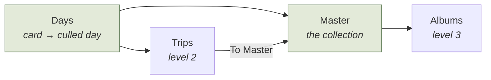

# Setup checklist — first run for a new user

*0.4, follows the zero-data simulation (docs/plans/multiple_masters_plan.md).
Skeleton: Gilbert, 2026-10-11. Status: DESIGN — nothing built.*

## Who it is for

A birder who has never seen SpeciesViewer, for whom the full product is too
much. SpeciesViewer is not Lightroom or PhotoLab: it is a *species* viewer. For
Gilbert it has taken over what PhotoMechanic (culling) and Lightroom
(cataloguing) did; PhotoLab stays for its JPG rendering and because it needs no
import into a database.

Most birders do not publish to the web. A website is therefore **optional**:
blogs only exist on the web, and the website steps are simply not needed by
someone who only wants their own collection.

## Levels — what a new user needs, in order

| Level | Menus | What it gives | Setup it needs |
|---|---|---|---|
| **1. Start** | File, Browser, Days, Master, Help (maybe Utilities) | Copy a day off a card, cull it, add it to the master, browse the collection. The Master menu is enough to maintain a database. | a master collection |
| **2. Core** | Trips, To Master | The trip pipeline: a trip of days, blogs, the merge into the master. | a trips folder |
| **3. Albums** | Albums | Conceptually built on trips, but also an alternative to them: *Days → Master → Album* works well on its own. | an albums folder |

A level whose setup is missing stays **greyed**, as today. Hiding those menus is
possible later; not proposed now.



## The checklist window

Help ▸ Setup checklist, opened by itself while the open master is not set up.
Every mark is derived from the real settings — never from "the user clicked
Next" — so the same window answers *"why is everything grey?"* at any later
moment, not only on day one. Each button opens the dialog that already exists
for that setting.

Rows (Gilbert's order; no order is strictly required). Marks: ✗ needed and
missing, ✓ done, – optional, *defaults* when a setting works untouched. Level
= which level the row unlocks.

```
Setting up SpeciesViewer                                                  level
 ✗  Master collection   where your pictures and species list live    [Create… / Choose…]   1
 –  Website publishing  optional — only to publish blogs and pages   [Set up…]
 ✗  Pictures folder     your working copies (e.g. D:\CurrentPictures) [Choose…]           2
 ✗  Trips folder        where trips are kept                         [Choose…]           2
 ✗  Albums folder                                                    [Choose…]           3
 ✓  exiftool            found: C:\Strawberry\…\exiftool.bat
    Decode Quality      defaults                                     [Change…]
 –  DxO PhotoLab        optional                                     [Locate…]
```

## Decisions (Gilbert, 2026-10-11)

1. **Website is optional**, and shown early in the list. What breaks without it
   is a separate question with its own plan: `docs/plans/website_optional_plan.md`.
2. **Create a new master** is close to creating a trip — most likely an option in
   the module they would share, not a new mechanism. Investigate first.
3. **Levels of the rows:** master collection → 1; pictures folder and trips
   folder → 2; albums folder → 3. The rows need no strict order.
4. **Decode Quality:** works on defaults; the row says so.
5. **exiftool** comes from the PATH today; the finished ZIP must ship it. Until
   then this is the row a new user fails on.

## Finding: Create Master (2026-10-11)

`batch/sv1MakeReposity.py` — the Create Trip module — already has a master
path: with `[master] MasterBiotaDatabase` empty it treats the folder as *the*
master (`Project.isMasterRepository()`). Tried in a scratch folder, no website:

- the data skeleton is created completely — `metadata/active/` with the empty
  CSVs and the 18,408-row starter `speciescollection.csv`, `admin/`, `biota/`,
  a local `web/` — and **opens as an empty master** (`MasterDB.ensure_fresh`:
  0 pictures, 0 files);
- it then **fails on the blog index** (`bloglib.updateIndexPage` needs a Trip):
  a trip-only step the master path never skipped — that path was started, never
  finished;
- the upload part is already skipped when the web root is empty — but
  `generate_svconfig_ini(master_mode=True)` falls back to `/nature/` and returns
  early when no master is configured, which is exactly a new user's situation;
- `species.csv` is created as a **0-byte file** (`empty_species.csv` has no
  header). Check against the species.csv rules before relying on it.
