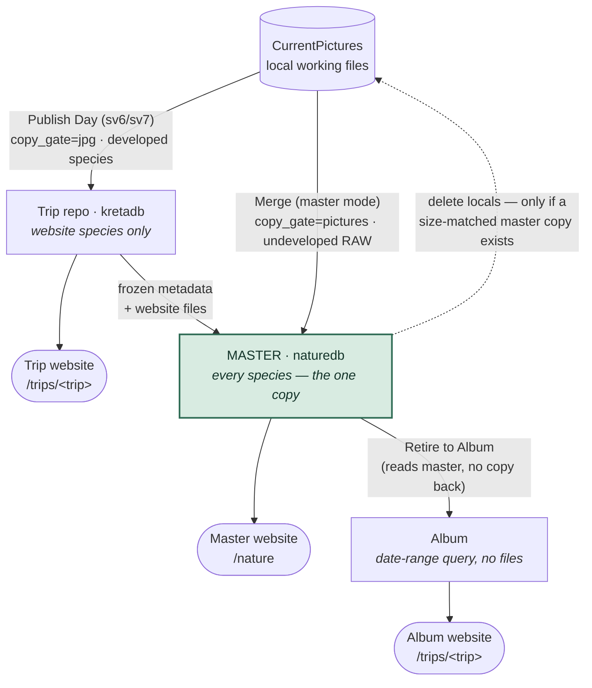
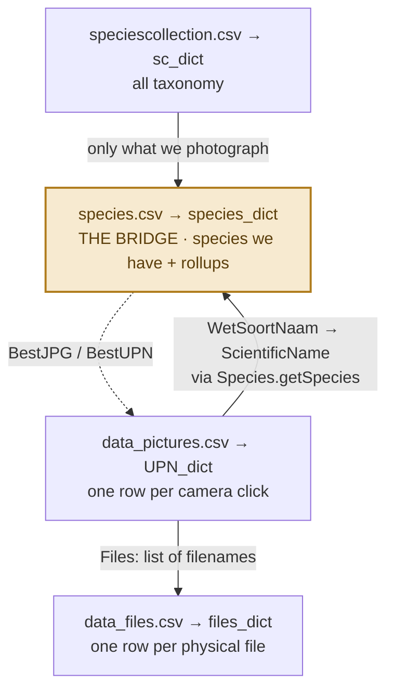
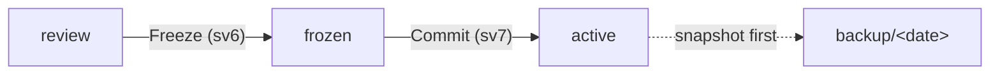

# 1. Architecture and dataflow

*For developers and coding agents. How pictures and metadata move from the camera
to the master, which code does it, and what must never break.*
Re-verified against the code on SpeciesViewer04, 2026-11-21. The user's view of
the same story is [Concepts](../manual/00-concepts.md); the four CSVs in detail are
[2. Data structures](../manual/appendix-e-data_structures.md).

---

## What you must never break

Read these before changing anything that copies, moves or deletes pictures.
Each one was learned from a real loss.

1. **The master is the only copy that lasts.** Once local originals are deleted,
   every master CSV row must have its file physically behind it.
2. **Deletes trust the disk, never a list.** A local original is removed only when
   a size-matched master copy is present on disk (`engine/trip_delete_scan.py`).
   Deletes go to a `.trash` folder first.
3. **Never write a master CSV down to 0 rows.** Never overwrite a source picture or
   sidecar with a derived file.
4. **The sidecar is the truth; caches are mirrors.** Every cache under
   `%LOCALAPPDATA%\SpeciesViewer\` is rebuildable and must never live in Dropbox.
5. **Check a write, not its exit code.** ExifTool can return 0 on a refused write.
6. **Trip mode and master mode share code.** A fix to sv2–sv7 must be correct in
   both (see [below](#one-code-path-two-targets)).

Bugs historically cluster in **remove and re-point** paths, not append paths.

---

## Four repositories

| Repository | Where | Holds | Role |
|---|---|---|---|
| **Local working pictures** | `<CurrentPictures>\<year>\<trip>\<day>` | The live RAW / XMP / JPG / DOP files. The originals. | Working set. Cleared under control once the master physically holds them. |
| **Trip repo** | `<tripsroot>\<trip>db` (e.g. `kretadb`) | Website species files only: developed pictures, per-day review metadata, blogs. | **Transient.** Powers the trip website; retired once an album exists. |
| **Master** | `<naturedb>` | Every species file across all trips, plus the canonical CSVs and `admin/`. | The long-lived, single copy. |
| **Album** | `<virttripsroot>\<name>` | **No pictures.** An `ini`, blogs, a cover: a saved date range over the master. On disk and in settings still called `virttrip`. | Reporting after the merge. Pages are built from the master's files; nothing is copied back. |

Plus **per-machine caches** (`utils/cache_paths.py`): EXIF cache, preview cache,
sidecar cache, the master SQLite read cache (`db/master_db.py`). Never a source of
truth, always rebuildable.

Most historical bugs were confusion about *which* repository a step was writing into.

---

## Where the files go

Two things to hold on to: the **master is fed from two sources** (developed files
via the trip repo, undeveloped RAWs straight from local), and **deletion is the
last arrow**.



### Why the delete walks the disk: the ghost-row incident

In mid-2026 two faults lined up. Freeze wrote master CSV rows for files it had
*not* copied (**ghost rows**), and the delete step chose what to remove by reading
that CSV *rather than the disk*. About 14,000 local originals were deleted whose
master copy existed only on paper.

Guardrails now in code:

- In master mode the merge copies *all* species (`copy_gate="pictures"`).
- A copy-verification step aborts Freeze if any file did not land.
- The delete **walks the files on disk**, refusing to remove a local unless a
  size-matched master copy is present (`engine/trip_delete_scan.py`).
- Before any bulk copy (card read, saving a card's keepers, work backup, Publish
  Day, Merge, Add to Master) the destination's free space is checked against the
  exact byte total, so a full disk refuses with nothing copied
  (`utils/disk_space.py`).

The moral: the delete trusted a list that lied; now it trusts the disk.

---

## The life of a trip, in code

The user's version is the lifecycle table in [Concepts](../manual/00-concepts.md#how-the-four-fit-together).
Here each step with what runs and where it writes. Module names per menu item are
in [Appendix B](../manual/appendix-b-batch-modules.md).

| # | Step | Runs | Writes into |
|---|---|---|---|
| 1 | **Ingest and cull.** Card → local; ratings, colours, names, GPS. Rejected frames → `<pictures>\.trash\<day>\<picture>\` (`engine/trip_trash.py`). | GUI, `gui/sidecar_provider.py` | Local sidecars |
| 2 | **Develop.** PhotoLab / Lightroom render JPGs, `.dop`, `.xmp` beside the RAWs. | outside SV | Local |
| 3 | **Per-day pipeline.** Read & Summarize → Write Blog → Publish Day (Freeze + Commit; Freeze builds the website, sv5 has no menu item of its own). Copies *developed* species only. | sv2, sv3, sv4, sv5, sv6, sv7 in **trip mode** | Trip repo |
| 4 | **Publish Trip to Master**: species names (svr5) → list the trip on the site → **Merge Pictures into Master**. The merge reads developed files via the trip's frozen metadata *and* undeveloped RAWs from local. | svr2 + svr7ArchiveVerdict (trip mode), then sv2–sv7 in **master mode** | Master |
| 5 | **Retire to Album.** The `/trips/<slug>` site is now generated from the master. | | Album folder |
| 6 | **Delete local files** — only each file the master physically holds, size-matched. Non-species files stay. | `engine/trip_delete_scan.py` | Local (to `.trash`) |
| 7 | **Remove the trip repo.** `CurrentPictures` and the master are untouched. | | Trip repo |

Steps 5 and 6 are independent once 4 is done.

**Side doors into the master**, bypassing the trip repo: *Add Pictures to Master*
(a folder or dragged pool, run as an ephemeral micro-trip) and *Days ▸ Add to
Master*. Same copy rules.

---

## One code path, two targets

`getRepositoryPath()` returns *the repo the current run writes into*:

- **Trip mode** (normal config) → the trip repo, e.g. `kretadb`.
- **Master mode** → the master. `isMasterRepository()` is true when
  `MasterRepository == ""`, i.e. the config's `[master] MasterBiotaDatabase` is
  empty or absent (`engine/projectlib.py`).

Trip Publish and the Merge run the *same* sv2–sv7 code; only the target differs.
So a fix to the copy logic must be correct in **both** modes, and the copy gate is
chosen by mode (`batch/sv6Freeze.py`):

```python
biota_gate = "pictures" if MyProject.isMasterRepository() else "jpg"
```

`copy_gate` picks which per-run counter decides whether a species subtree's files
are copied: `jpg` = only species with a developed JPG; `pictures` = every
identified picture.

---

## The data model, in brief

The same four structures exist in every repository. Two describe **biology**, two
describe **your photos**; they meet at one join, a scientific-name string. Full
detail: [2. Data structures](../manual/appendix-e-data_structures.md).

| CSV | In memory | Holds |
|---|---|---|
| `speciescollection.csv` | `sc_dict` | Pure taxonomy. Seeded with a full bird list, grown to other kingdoms via GBIF. |
| `species.csv` | `species_dict` | **The bridge**: the taxonomy subset you have pictures of, plus rollups (best JPG, counters, target path). |
| `data_pictures.csv` | `UniquePictureName_dict` | One row per **camera click** (UPN), grouping its files + distilled metadata. |
| `data_files.csv` | `files_dict` | One row per **physical file**: RAW, sidecars, renders. |



The halves join at picture-write time in `Species.getSpecies`, which resolves
whatever is in `XMP:Subject` (Dutch, English, scientific, misspelled, a local
name, with a qualifier) to a canonical scientific name; an unknown name calls GBIF
and grows the taxonomy.

**UPN:** the lowercased filename stem with software suffixes stripped (`-DxO`,
`_DxO`, `-orf`, `-nef`, ` - copy`…), so `_O9173432.ORF`, `.XMP`, `-DxO.dng` and
`-DxO.jpg` collapse to one picture. Uniqueness comes from a user-supplied prefix
such as `2026 Kreta-`, not from EXIF.

**Column order:** `engine/csv_columns.py` is the source of truth. New columns go at
the **end**: frozen CSVs are re-headed by position.

---

## Editing: write-through, cache-first reads

- **Reading is cache-first.** Opening a folder does not run ExifTool on every file.
  A per-folder JSON cache under `%LOCALAPPDATA%` is checked against each file's
  mtime; a hit costs one `stat()`. Previews come from a separate image cache.
- **Editing writes through, immediately.** Rating / colour / description go to the
  `.xmp` via the one shared stay-open ExifTool; crop and exposure also to the
  `.dop`, except while PhotoLab is running. The in-memory value and the cache
  entry are updated in the same step. There is no buffer to flush on close.

> **Sidecar vs. cache — the distinction that has bitten us.** The mirror drifted,
> the edit was never lost: a partial write once re-stamped the cache timestamp as
> if the whole row were current (hiding a just-written GPS coordinate), and a cache
> kept in Dropbox failed to save silently. Fixed: a partial write now
> **invalidates** the entry, and caches live on the local disk.

---

## review → frozen → active

Every Publish / Commit moves a batch through three trays of CSVs under
`metadata/`:

- **review** — the batch being worked on: one day, one import, one dragged pool.
- **frozen** — a snapshot to eyeball (and hand-edit) before committing.
- **active** — the committed collection the website and the master are built from.



On read, *active* wins over an in-flight *review*. On commit, each species'
per-run counters fold into its totals and reset. Nothing that publishes a page
looks at the picture folders: pages are built from these CSVs only
([Appendix F](../manual/appendix-f-page-freshness.md)).

In a trip all of this is local and disposable: every edit was already written to
the source sidecars, so the trip repo and its website can be rebuilt from source.
Re-publishing overwrites the remote site in place; it is not torn down first.

---

## Code map

| Concern | File |
|---|---|
| Column lists for all four CSVs | `engine/csv_columns.py` |
| Project orchestration, mode, files & pictures dicts | `engine/projectlib.py` |
| Taxonomy, GBIF lookup, master/trip name merge | `engine/speciesclassification.py` |
| Counters, best-JPG rollup | `engine/specieslib.py` |
| CSV read/write, UPN derivation | `engine/handling.py` |
| Per-day step state and invalidation | `engine/statemachine.py` |
| Culling reads/writes (sidecar cache, write-through) | `gui/sidecar_provider.py` |
| Freeze, copy gate | `batch/sv6Freeze.py` |
| Commit | `batch/sv7WriteCommit.py` |
| Culling trash | `engine/trip_trash.py` |
| Ground-truth delete (walks disk, size-matches master) | `engine/trip_delete_scan.py` |
| Free-space check before bulk copies | `utils/disk_space.py` |
| Master SQLite read cache | `db/master_db.py` |

---

## On complexity — a note for later

In the author's words: *"when I made the process it seemed logical, but it is
terribly complex."* Two sources feeding the master, a transient website-only trip
repo, and `getRepositoryPath()` meaning different things in different modes:
many parts for "get the pictures into the master and clean up." This chapter makes
it legible. A later pass could **simplify** it: one merge source, or Publish and
Merge folded together.
